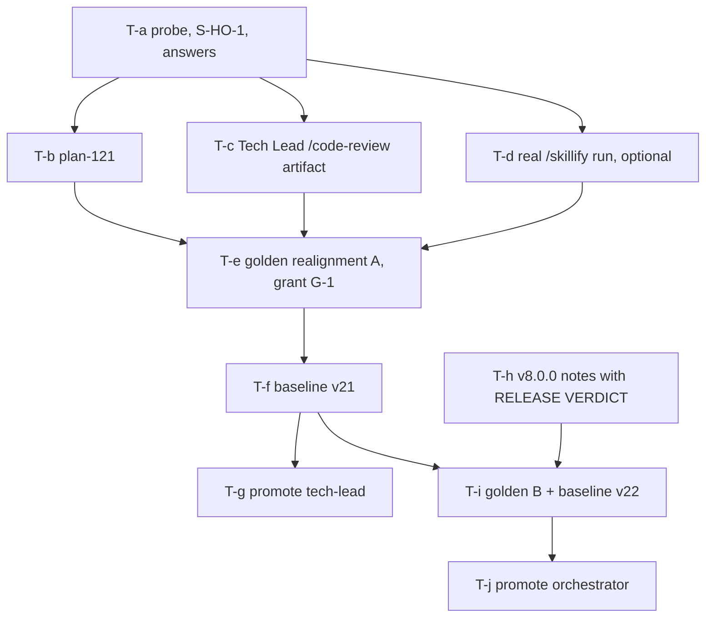

# Artifact: promotion-and-golden-realignment-plan-v1.md

> Filename: `promotion-and-golden-realignment-plan-v1.md`. Immutable once produced; revisions bump `<N>`.

## Metadata

- **Producer agent**: solution-architect
- **Task**: T622 (P1, judgment tier, decision and plan only)
- **Created**: 2026-10-09
- **Based on**:
  - `docs/tasks/task-T622.md` (the brief, authoritative) and `docs/plans/plan-120-release-v8-readiness.md` (WS E);
  - `docs/artifacts/maturity-promotion-criteria-v2.md` §3.1 (agent criteria 1-7) and §3.5 (shared defect check);
  - `docs/artifacts/agent-promotion-rerun-v1.md`, `promotion-rule-v1.md`, `phase3-wave3-promotion-v1.md`,
    `command-promotion-readiness-v1.md`, `command-contract-resolution-v1.md` (history, not trusted: each claim below was
    re-checked against the live files named in §2);
  - `docs/artifacts/protected-paths-v1.md` §3 and §5, `evaluator-hash-check-v1.md`,
    `evaluator-hash-known-good-v20.json`, `implementation/runtime/golden_harness/evaluator_hash.py`,
    `implementation/scripts/check-maturity.py`, `tests/golden/README.md`;
  - `docs/artifacts/remaining-verdict-renderings-v1.md` §8.4 O3;
  - `docs/decisions/ADR-007-command-contract-authority.md` and `ADR-008-knowledge-document-authority.md` (both Accepted);
  - `docs/tasks/task-T601.md` (the precedent for a file-scoped grant plus a user-approved baseline).
- **Supersedes**: none (first version).
- **Decision references**: PG-1 to PG-9 (§5). No new ADR: every ruling applies ADR-007 (branches 2 and 3b) or ADR-008 P4,
  and no criterion changes (§5, PG-8). Requirements version: this task has no `requirements-vN.md`; the user's decisions
  below are the requirement.

## 0. Outcome summary (read this first)

1. **Neither agent can leave `experimental` today, and neither can be promoted by editing a file.** Both fail exactly
   criteria **#3 and #7** of §3.1, and no other. The cause is the golden half of §3.5: a `known_failing` case with
   `known_failing_category: tracked_defect` for a command the agent owns. `orchestrator` owns 14 commands, and 3 open
   cases block it. `tech-lead` owns `/code-review`, and 1 held-out case blocks it.
2. **All 4 blocking cases are ADR-007 branch 3b (omission, fix the corpus).** Each exits only by producing one genuine,
   conforming artifact and re-fixturing the case against it, with the `check()` byte-identical. Nothing in §3.5 is
   changed, and no case is reclassified to make a pass.
3. **The exits come from real work in four different places**: a `/plan`-conformant plan document (now), a
   `/code-review`-conformant Tech Lead review (now), a real `/skillify` run (needs the user), and the first
   `docs/releases/v8.0.0.md` carrying `## RELEASE VERDICT` (only at release preparation, workstream G).
4. **Recommended shape: two baselines.** Baseline **v21** (authorized) carries everything that can be earned before the
   release, and promotes **`tech-lead`**. `orchestrator` needs the v8.0.0 release notes, so its promotion needs a second,
   separately approved baseline **v22** after the tag. If the user prefers otherwise, §13 gives the options.
5. **Three golden cases are `capability_gap`** (two "conditions" gaps and one CRITICAL-not-FAIL demonstration). They do
   not block under §3.5 as written and need no action. Reclassifying them would be wrong (§4.4).
6. **Held-out limit.** I may not open `tests/golden/held-out/`, so `tech-lead`'s one blocker is classified from
   committed, identity-withheld history plus the redacted scorecard (command, status, category). The plan makes the
   orchestrator's read/audit step (S-HO-1) the first action on that path, and gives a stop rule.
7. **Two findings the user should know** (F-1, F-2 in §4.5): `docs/plans/_template.md` declares a different plan header
   vocabulary from `/plan` step 5, and `/skillify`'s template omits the `maturity` field its own registry step requires.

## 1. The user's words (verbatim) and what they authorize

The user's decisions of 2026-10-09 on the release-readiness question (`plan-120` § Based on): "1. A  2. A  3. A  4.
approving baseline v21 - plan re-evaluation and steps to bring them out of experimental  5. C  6 B".

Point 4, as the orchestrator relayed it: "the user authorizes evaluator baseline v21 and asks for a re-evaluation plan and
the steps to bring `orchestrator` and `tech-lead` out of `experimental`".

Read exactly: the user authorized **one baseline, v21**, and asked for a **plan and steps**. The user did not authorize
any criterion change, any case reclassification, any `known_failing` flip by edit, or a second baseline. This artifact
applies nothing. Grants are drafted for approval (§6.3, §6.4).

## 2. Method and limits

- **Live files re-read in this session** (worktree `agent-solution-architect-T622`, branch from `develop` `5e07a6b`):
  `check-maturity.py` (whole), `implementation/registry/summary.md`, `docs/tasks/active-tasks.md` and the five active
  briefs' headers (T619-T623), `agents/orchestrator.md` and `agents/tech-lead.md` (whole), `docs/wiki/agents-overview.md`,
  all 19 command files' `agent:` frontmatter, `commands/{plan,code-review,prepare-release,new-feature,new-project,skillify}.md`
  (whole), `skills/skillify/SKILL.md`, `schemas/skill.schema.json`, `docs/releases/v7.0.1.md`, `docs/plans/_template.md`,
  `scripts/scorecard.py` (docstring and discovery), `docs/benchmarks/scorecard-v6.12.0.{md,json}` (the published scorecard;
  held-out rows are redacted there), `test_check_maturity.py:518-535`, `test_golden_harness_evaluator_hash.py` (whole),
  `evaluator_hash.py` (whole), `evaluator-hash-known-good-v20.json`, and `task-T601.md`.
- **Open golden cases re-read**: for the six `known_failing` open cases, `case.yaml`; plus `brief.md` for all six except
  that I read only the first 40 lines of the CRITICAL-not-FAIL brief; `expect.py` for `plan-real-doc-header-drift`,
  `prepare-release-real-verdict-missing`, `skillify-skill-file-template-drift`, `code-review-conditional-pass-conditions-gap`;
  `case.yaml`, `brief.md` and `expect.py` of `new-project-plan-doc-and-lifecycle-states`; `expect.py` of
  `plan-required-sections-compliant`. The other open cases were not opened; their status comes from the published
  scorecard **(unverified live)**, whose counts match `plan-120` §header (34 cases, 26 pass, 0 regressions; open 28, held-out 6).
- **Never opened**: `tests/golden/held-out/`, `.env*`, any credential or key file. No held-out case id is written here.
  Where a held-out case matters it is described only by public attributes (command, status, category) that the published
  scorecard already carries.
- **No shell.** I ran nothing: not `check-maturity.py`, not the suite, not `scorecard.py --check`, not `grep`. Every
  "PASS by reading" below is a reading, and §15 lists everything unverified. The first step of the plan (S0) is a
  mechanical probe that replaces my reading.

## 3. Current criteria status (§3.1 of `maturity-promotion-criteria-v2.md`), re-evaluated live

Criteria 1-3 are the `experimental -> beta` bar, 4-7 add `beta -> stable`. `check-maturity.py` applies the golden half of
the defect check at **both** tiers (`_open_defect`, `check-maturity.py:532-544`), so criteria 3 and 7 fail together and a
`beta` stop is not available (§13, option C).

### 3.1 `orchestrator` (`maturity: experimental`)

| # | Criterion | Status | Live evidence |
|---|---|---|---|
| 1 | Schema-valid frontmatter | PASS (by reading; not run) | `name`, `description`, `tools`, `agents`, `maturity` present (`agents/orchestrator.md:1-7`). The checker skips schema for `experimental` components (`check_component` returns early), so the proof is `test_schemas.py`, part of the 1087-test suite `plan-120` reports green **(unverified: not re-run)** |
| 2 | `## Rails` with Inputs / Out of scope / Failure mode | PASS | `orchestrator.md:284-288`, all three labels non-empty |
| 3 | No open `P0` defect | **FAIL** | Ledger half passes: the 5 active rows (T619-T623) are all `P1` and all declare `**Affects:** —`. Golden half fails: 3 open cases `known_failing` + `tracked_defect` on owned commands, below |
| 4 | Golden / test evidence | PASS | 4(i): the agent owns 14 commands (`agent: "orchestrator"` in `batch`, `bug-report`, `consolidate-memory`, `discover-skills`, `handoff`, `new-feature`, `new-project`, `plan`, `prepare-release`, `skillify`, `sprint-status`, `team-status`, `validate-tasks`, `validate-workflow`). Many `expected_pass` cases exist for them (scorecard). No `maturity-evidence` tag is needed |
| 5 | Cross-referenced | PASS | `command_agent` values include `orchestrator` (14 commands); `@orchestrator` in `docs/wiki/agents-overview.md:11` |
| 6 | Documented in `docs/wiki/**` | PASS (by reading) | `agents-overview.md:11`: the line has well over 40 non-whitespace characters and 8 distinct word tokens after the id is removed, which clears `_looks_like_real_description` (`check-maturity.py:185-226`) |
| 7 | No open `P0` or `P1` defect | **FAIL** | Same three cases (the golden half is tier-independent) |

**Blocking cases, in the order the checker would report them** (it returns the first hit only, sorted by directory name,
`open` then `held-out`: `check-maturity.py:520-529`, `817-828`; so a clean run needs one re-run per cleared case):

1. `plan-real-doc-header-drift` (`/plan`), `tracked_defect`.
2. `prepare-release-real-verdict-missing` (`/prepare-release`), `tracked_defect`.
3. `skillify-skill-file-template-drift` (`/skillify`), `tracked_defect`.

No held-out case blocks `orchestrator`: the published scorecard's held-out rows for `/new-feature`, `/prepare-release`
and `/security-audit` are `expected_pass`, and its held-out `/plan` row is `capability_gap`.

### 3.2 `tech-lead` (`maturity: experimental`)

| # | Criterion | Status | Live evidence |
|---|---|---|---|
| 1 | Schema-valid frontmatter | PASS (by reading; not run) | `name`, `description`, `tools`, `user-invocable`, `maturity` (`agents/tech-lead.md:1-7`); same `test_schemas.py` proof |
| 2 | `## Rails` | PASS | `tech-lead.md:191-195` |
| 3 | No open `P0` defect | **FAIL** | Ledger half passes (as above). Golden half: **one held-out** case, `known_failing` + `tracked_defect`, `command: /code-review` (the redacted scorecard row shows exactly one such row). Its id is not written here (§9) |
| 4 | Golden / test evidence | PASS | `/code-review` is `tech-lead`'s only owned command (`commands/code-review.md:3`); open `/code-review` cases exist (`code-review-fail-blocker-details`, `expected_pass`) |
| 5 | Cross-referenced | PASS | `agent: "tech-lead"` on `/code-review`; `@tech-lead` in `orchestrator.md:202,206,239,249`; `agents-overview.md:23` |
| 6 | Documented in `docs/wiki/**` | PASS (by reading) | `agents-overview.md:23`: 8 word tokens, 7 distinct, over 40 characters after the id is removed |
| 7 | No open `P0` or `P1` defect | **FAIL** | Same held-out case |

**Only one case blocks `tech-lead`, and it is a held-out case.** The open `/code-review` case
`code-review-conditional-pass-conditions-gap` is `capability_gap` and does not count.

### 3.3 What the checker will print, and a leak to avoid

`_golden_tracked_defect` prints `golden case <id> is a known_failing tracked_defect for /<command>` with the **real**
id read from `case.yaml`, including for a held-out case (`check-maturity.py:528`). A probe of `tech-lead` at `stable`
therefore prints a held-out id to the terminal. Nothing may copy that line into a brief, artifact, commit message,
checkpoint or ledger row: `tests/functional/test_golden_held_out_isolation.py` Check B fails the build on a held-out id
outside `tests/golden/`. `agent-promotion-rerun-v1.md` §2 row 8 withheld it for the same reason.

## 4. Case-by-case classification

Vocabulary used: **`tracked_defect`** is `tests/golden/README.md`'s "a known, expected-to-be-fixed bug"; **`capability_gap`**
is its "a deliberate demonstration that the command surface doesn't support something yet". The brief's shorthand
("text changes will not fix it") is stricter; §4.4 shows what it would change and why I do not adopt it.

### 4.1 The four blocking cases

| # | Case | Command | Today | Classification | Branch (ADR-007) | Why |
|---|---|---|---|---|---|---|
| B1 | `plan-real-doc-header-drift` | `/plan` | `known_failing` / `tracked_defect` | **`tracked_defect`, stays** | 3b | The command's step 5 still declares six headers (`commands/plan.md:17-23`); the fixture is a verbatim copy of a shipped plan that uses others. The path half of the old defect is already amended (`plan.md:17` now reads `docs/plans/plan-<ID>.md`, matching `AGENTS.md`). Heterogeneous corpus, no single alternative to defer to (`command-contract-resolution-v1.md` §5), so 3a does not fire |
| B2 | `prepare-release-real-verdict-missing` | `/prepare-release` | `known_failing` / `tracked_defect` | **`tracked_defect`, stays, but mis-targeted (O3)** | 2 then 3b | `prepare-release.md:38-41` now makes `docs/releases/v<version>.md` the verdict's home, "not the release checkpoint from step 6". The case still reads `fixture/docs/checkpoints/*.md` (`expect.py:55-61`). Wrong artifact class, so the case cannot evidence a defect as built (branch 2, re-fixture). Against the right class, the shipped notes still omit the block (I read `docs/releases/v7.0.1.md` in full: no `## RELEASE VERDICT`), so the defect is real (3b) |
| B3 | `skillify-skill-file-template-drift` | `/skillify` | `known_failing` / `tracked_defect` | **`tracked_defect`, stays** | 3b | The five sections in `commands/skillify.md:70-83` are a subset of the skill's template in order; the corpus follows neither (0 of 26, per the case's fence-aware measurement; **not re-measured here**). Branch 1 does not fire (no quotable `AGENTS.md`/stable-instruction/same-file contradiction on the five sections). 3a does not fire (heterogeneous corpus). See F-2 for a separate same-file defect that does not touch this case |
| B4 | the held-out `/code-review` case | `/code-review` | `known_failing` / `tracked_defect` | **`tracked_defect`, stays, per history** | 3b | `command-contract-resolution-v1.md` §3 "H-2" (2026-09-25): omission, fixture is a verbatim shipped artifact not produced by the command, never passes as fixtured; `command-promotion-readiness-v1.md` §5 repeats it. **Not re-read live (held-out).** Step S-HO-1 (§6.1) makes the live read |

**None of the four can honestly pass as fixtured, and none should be made to.** A frozen historical fixture cannot be
retro-edited (`AGENTS.md` immutability; ADR-007 branch 3b). The only honest exit, stated by ADR-007 itself, is: "produce
one conforming artifact of that class and re-fixture the case against it" (ADR-007 §3b), and ADR-007 Validation 5: "the
next plan document and code review conform to their declared contracts ... If instead they are quietly reclassified or
retired, branch 3b was not implemented; it was evaded."

**Minimum honest step per case** (all keep `check()` unchanged, apart from B2's two path lines):

| Case | Minimum honest step | When it is available |
|---|---|---|
| B1 | A genuine `/plan` output, authored to the command's six headers as the working plan for real tasks (plan-121 or the next free number), reviewed by someone other than its author, then re-fixtured | Now: Wave 2 needs a plan document anyway (`/plan` Task Creation Precondition) |
| B2 | Stage 1: retarget the case to the correct artifact class (fixture: byte-identical `docs/releases/v7.0.1.md`), result stays `False`. Stage 2: when `docs/releases/v8.0.0.md` exists with its `## RELEASE VERDICT`, re-fixture to a byte-identical copy | Stage 1 now; Stage 2 only after the v8.0.0 notes exist (workstream G) |
| B3 | A genuine `/skillify` run (4-round interview with the user, user approval at the end) producing one skill file, then re-fixture | Needs the user (§13 Q2) |
| B4 | A genuine Tech Lead review produced under the `/code-review` contract, then re-fixture, only if S-HO-1 confirms the held-out check is satisfiable by following the **public** contract | Now, after S-HO-1; needs the user's authorization to touch a held-out case (§13 Q3) |

### 4.2 Why a "genuine" artifact is not "evidence authored to force a pass"

`agent-promotion-rerun-v1.md` §4 refused to author evidence to convert a FAIL. That refusal concerned authoring
documentation, ledger rows and cases whose only purpose was the checker. ADR-007 §3b draws the line differently and the
user accepted it: the contract is authoritative, and the exit is conforming output. The counter-reading is real (an author
who knows the check can write to it), so the plan binds four guards, each testable:

1. The artifact is the working document of real work (a plan that drives the Wave 2 tasks; a review of a real MR; a skill
   the user actually wants; the real v8.0.0 notes). It is committed through the normal MR flow before the fixture copy
   exists.
2. It is authored to the **public command text** only. For B4 the author never sees the held-out check.
3. The fixture is a **byte-identical copy** (`cmp`), and `expect.py` is **byte-identical** to the pre-edit file (B1, B3,
   B4). B2's `expect.py` differs in the path lines only (§6.3 item 3).
4. A reviewer other than the author checks the artifact against the command text, and the orchestrator re-runs the
   case's `check()` on a scratch copy with one required element removed and sees `False` (discrimination probe).

### 4.3 Other cases the brief lists

| Case | Classification | Action |
|---|---|---|
| `new-project-plan-doc-and-lifecycle-states` (`expected_pass`) | Not a defect. **Stale prose**: `brief.md:65-66` quotes step 18's format as `<artifact-name>-v<major>.<minor>.md`; live `commands/new-project.md:51` reads "Format: `<artifact-name>-v<N>.md`, per `AGENTS.md` § Artifact Versioning". The brief is documentation; `check()` never reads it, so no case result changes | Fix under the grant (§6.3 item 1). Same family as the T601 brief edits |

### 4.4 The three `capability_gap` cases: stay as they are

| Case | Command | Why `capability_gap` stands |
|---|---|---|
| `code-review-conditional-pass-conditions-gap` | `/code-review` | Hand-authored (tag `hand-authored`), no corpus (ADR-007 branch 4). The `## VERDICT` template has no `**Conditions**:` field (`commands/code-review.md:38-49`; step 51 only says "list the conditions, each with an owner and a due point") |
| `prepare-release-conditional-pass-conditions-gap` | `/prepare-release` | Same shape (`prepare-release.md:45-59` has no `**Conditions**:` slot; step 9 only says "list the conditions") |
| `security-audit-critical-not-fail` | `/security-audit` | ADR-007 branch 4, reclassified at T520; the rule must not be relaxed (`security-guidelines.md` Immutable Security Constraints). Already non-blocking: `/security-audit` and `security-engineer` are `stable` |

They do not block either agent under §3.5 as written (the golden half counts `tracked_defect` only). **No action.**

**On the brief's shorthand.** If `capability_gap` meant only "text changes will not fix it", the two "conditions" cases
would read as `tracked_defect` (adding a `**Conditions**:` field is a text change). I do not adopt that reading: it is not
the README's definition or ADR-007's, adopting it would add two new blockers (one for each agent) to a label change, and
adding the field is a command-contract change that only a user decision can make (ADR-007 branch 1 lists everything that
can defeat a command clause; ADR-008 P2 forbids amending a command from a skill or agent). If the user nevertheless wants
the field, that is a separate ruling, and it would need new cases; it is not a step toward promotion.

### 4.5 Findings that surfaced (not fixes; no edits proposed here)

- **F-1: three plan header vocabularies.** `/plan` step 5 declares six headers (`Goal`, `Task Decomposition`, `Dependency
  Graph`, `Resource Assignments`, `Risk Assessment`, `Open Questions`). `docs/plans/_template.md:6-61` declares `Goal`,
  `Scope`, `Task graph`, `Agent assignments`, `Artifact flow`, `Risks & mitigations`, `Token budget`, `Approval`; and
  `orchestrator.md:23-29` lists a third, prose, set. A plan that follows the template cannot satisfy B1's check, and the
  repo's practice follows neither. This explains the corpus drift behind B1. It does not change B1's classification:
  adding sections is a specialisation (ADR-008 D4), so a plan can carry the six headers and the template's extra sections
  (jointly satisfiable, Step A). Recommended: a ruling on which vocabulary a plan follows, after v8.0.0 (P32 family).
  **Not decided here.**
- **F-2: `/skillify`'s template is not registry-valid.** `schemas/skill.schema.json` requires `maturity` (`"required":
  ["name", "description", "maturity"]`, `additionalProperties: false`). The template at `commands/skillify.md:62-66` declares
  only `name` and `description`, while the same file's "Then" column (`:37`) regenerates the registry, which hard-fails on a
  missing `maturity`. A skill generated verbatim from the template fails the schema. That is a same-file contradiction
  (ADR-007 branch 1, third prong), but it concerns frontmatter that B3's `check()` does not assert, so it does not clear
  B3. A genuine `/skillify` run for B3 will meet it and must add `maturity: experimental` by judgement. Recommended: the user
  rules on amending the template (§13 Q2, part b). **Not decided here.**

## 5. Decisions

| Id | Decision | Basis |
|---|---|---|
| PG-1 | Promote **straight to `stable`**, not via `beta`. | Criteria 3 and 7 share one golden check, so `beta` and `stable` clear together; criteria 4-6 already pass. A `beta` stop would need a criteria change (PG-8) |
| PG-2 | Every blocking case exits by a genuine conforming artifact plus re-fixture, never by a status flip alone. | ADR-007 §3b, §5; Validation 5 |
| PG-3 | **Two baselines**: v21 now, v22 after the v8.0.0 notes exist. v22 needs its own approval. | B2's honest exit does not exist before the release notes do (§4.1). The user authorized one baseline only (§1) |
| PG-4 | The held-out blocker is handled by predicate (command + status + category), never by id, and the orchestrator reads it first (S-HO-1). | `protected-paths-v1.md` §3 (standing read/audit); `command-contract-resolution-v1.md` §1 ("The implementing task will be authorized to read `tests/golden/held-out/`") |
| PG-5 | Correct B2's artifact class **now**, inside v21, even though it clears nothing. | ADR-007 branch 2; `remaining-verdict-renderings-v1.md` §8.4 O3. Keeps the record truthful before the release gates read it |
| PG-6 | Fix the stale brief quote inside v21 (documentation only). | §4.3 |
| PG-7 | Leave the three `capability_gap` cases untouched. | §4.4 |
| PG-8 | **No criterion, checker, schema or test is weakened or changed.** The only test edit is the maturity-distribution snapshot, as in T514 §4.1. | The brief; ADR-007 §5; ADR-008 P4 (maturity never ranks) |
| PG-9 | Promotion is decided by `check-maturity.py`, then independently re-run by the top-level session. For `tech-lead`, which both authors the B4 exit artifact and is the agent promoted, the independent check is mandatory, not optional. | `agent-promotion-rerun-v1.md` §5 (disclosed conflict of interest) |

## 6. The steps, in order

### 6.1 Stage 0: probe and decisions (no file edited)

| Step | Action | Who | Output |
|---|---|---|---|
| **S0** | Baseline probe in a **throwaway detached worktree**: set `maturity: stable` on both agent files, run `python3 implementation/scripts/check-maturity.py --root implementation --verbose`, expect FAIL on `agent/orchestrator` and `agent/tech-lead` at #3 and #7 (first case `plan-real-doc-header-drift` for the first; a held-out id for the second, **not to be copied anywhere**). Discard the worktree. Confirms §3 mechanically | orchestrator (shell) | A line in the checkpoint: "S0 confirmed: both fail #3 and #7 only" |
| **S-HO-1** | Read/audit, orchestrator only: open the single held-out case with `command: /code-review`, `status: known_failing`, `known_failing_category: tracked_defect`; read its `case.yaml`, `brief.md`, `expect.py`. Report **without naming it**: (a) the ADR-007 branch; (b) whether a genuine review that follows the **public** `/code-review` text would satisfy `check()`; (c) whether the cause is a command-text defect (a branch-1 amendment, user decision) or pure omission. **Stop rule**: if (b) is "no" or (c) is "command-text defect", stop the B4 path and put a question to the user; do not brief an agent to make the check pass | orchestrator (read/audit) | Three sentences in the T-e brief (golden task), no id |
| **S-Q** | Put §13 to the user and record the verbatim answers | orchestrator | Answers in the plan-121 text |

### 6.2 Stage 1: golden realignment A, baseline v21

Order matters: the exit artifacts must be merged **before** the golden task copies them.

| Step | Action | Depends on |
|---|---|---|
| **S1** | **plan-121** (or next free number): the orchestrator authors the Wave 2 plan as a genuine `/plan` output, with `## Goal`, `## Task Decomposition`, `## Dependency Graph` (Mermaid), `## Resource Assignments`, `## Risk Assessment`, `## Open Questions`, in that order, each as a `##` heading (a numbered `## 1. Goal` does not match `check()`'s substring test). It may add the template's other sections (F-1, Step A). Every task id created from it appears in its text. Merged by MR before any task row is created (`/plan` Task Creation Precondition) | S-Q |
| **S2** | **Tech Lead review under `/code-review`**: delegate the review of one Wave 1 MR (T619 or T620) to `@tech-lead` as a full `/code-review`: steps 8-9 (artifact versions) and the `## VERDICT` block with every field of `code-review.md:38-49`. Store as an immutable artifact `docs/artifacts/code-review-<scope>-v1.md` (name is my proposal, **unverified convention**), merged by MR | S-HO-1, T619/T620 MR open |
| **S3** | **`/skillify` run** (only if the user chose to supply a workflow, §13 Q2): the orchestrator runs the 4-round interview with the user; output to `implementation/knowledge/skills/<name>/SKILL.md`; sync and registry regenerated; user approves the draft. Needs `maturity:` in the frontmatter (F-2). May be deferred to Stage 2 | S-Q |
| **S4** | **Golden task under grant G-1** (§6.3): items 1-3 always, item 4 if S3 is done, item 5 if S-HO-1 allowed it and S2 is merged | S1, S2, (S3), grant approved |
| **S5** | **Baseline v21** (§7): orchestrator writes `evaluator-hash-known-good-v21.json`, repoints `evaluator_hash.py`, regenerates `docs/benchmarks/scorecard-v6.12.0.{json,md}` if any status or category changed | S4, independent verification |
| **S6** | **Promote `tech-lead`** (§10) if and only if S5 cleared B4. Otherwise nothing is promoted in Stage 1 | S5 |

### 6.3 Grant G-1 (drafted for the user's approval; applies nothing)

**This task, the golden task under `plan-120` WS E ("T-e" in §11), is the authorizing task** (`protected-paths-v1.md` §5.2:
the brief must state that it is authorized to modify a protected path and cite `protected-paths-v1.md`). The
orchestrator authors the brief. The grant covers exactly these files and only the text named:

| # | File | Change |
|---|---|---|
| 1 | `tests/golden/open/new-project-plan-doc-and-lifecycle-states/brief.md` | The bullet at `:65-69` only. Replace `` `<artifact-name>-v<major>.<minor>.md` `` with `` `<artifact-name>-v<N>.md` `` and cite `AGENTS.md` § Artifact Versioning, as step 18 now reads. Re-verify the rest of the bullet against the live `commands/new-project.md` step 14 and the live sibling case `new-feature-checkpoint-line-compliant` and report; edit a clause only if it is provably false. No other line |
| 2 | `tests/golden/open/prepare-release-real-verdict-missing/case.yaml` | `known_failing_reason` text only. `status`, `known_failing_category`, `command`, `tags` unchanged |
| 3 | `.../prepare-release-real-verdict-missing/expect.py` | Branch 2 re-target: the docstring, and the directory the fixture is read from (`fixture/docs/checkpoints` becomes `fixture/docs/releases`, with the variable renamed). `REQUIRED_FIELDS` (11 names), `ALLOWED_STATUS`, `VERSION_RE`, `_verdict_section` and the `check()` logic: **byte-identical**. The implementer prints `diff` and `git diff --stat` for this file in the report |
| 4 | `.../prepare-release-real-verdict-missing/brief.md` | Rewrite "Command under test", "Why this is known_failing today" and "Category" for the release-notes class and the v7.0.1 fixture. Keep the historical note that the original fixture was a release checkpoint and why it was retargeted (O3) |
| 5 | `.../prepare-release-real-verdict-missing/fixture/docs/checkpoints/checkpoint-release-v6.4.1.md` | Delete |
| 6 | `.../prepare-release-real-verdict-missing/fixture/docs/releases/v7.0.1.md` | Add; byte-identical copy of `docs/releases/v7.0.1.md` (`cmp` in the report) |
| 7 | `tests/golden/open/plan-real-doc-header-drift/case.yaml` | `status: expected_pass`; remove `known_failing_category` and `known_failing_reason`; tags unchanged |
| 8 | `.../plan-real-doc-header-drift/brief.md` | Replace "Why this is known_failing today" and "Category" with the provenance of the new fixture and the history (formerly `known_failing`, exit per ADR-007 §3b) |
| 9 | `.../plan-real-doc-header-drift/fixture/docs/plans/plan-030-mcp-remote-transport-alignment.md` | Delete (it is a copy; the shipped original is untouched) |
| 10 | `.../plan-real-doc-header-drift/fixture/docs/plans/plan-121-<slug>.md` | Add; byte-identical copy of the merged plan. `expect.py` of this case: **unchanged** |
| 11 | *(conditional on S3)* `tests/golden/open/skillify-skill-file-template-drift/{case.yaml,brief.md}` and `fixture/` | `status: expected_pass`, drop the two `known_failing_*` keys; replace the fixture with a byte-identical copy of the generated skill at `fixture/implementation/knowledge/skills/<name>/SKILL.md` (one of the eight declared roots, `expect.py` `DECLARED_SKILL_ROOTS`), delete `fixture/.github/skills/verification-before-completion/SKILL.md`; rewrite the brief's history sections. `expect.py` **unchanged** |
| 12 | *(conditional on S-HO-1 and Q3)* the one directory under `tests/golden/held-out/` selected by the predicate in S-HO-1 | `case.yaml` status flip as in item 7; fixture swapped for a byte-identical copy of the S2 artifact; `brief.md` history. `expect.py` **unchanged**. The implementer may open **only** the six held-out `case.yaml` files (to find the predicate match) and then only that one directory |

**Not authorized**: any other `expect.py`, `case.yaml`, fixture or case; any other file in `tests/golden/`;
`scripts/scorecard.py`; `evaluator_hash.py`; `evaluator-hash-known-good-v*.json`; `tests/golden/README.md`.

**Controls (the implementer must report each)**:

- **No weakening.** For every case, the `check()` source of items 7, 10, 11 and 12 is byte-identical (`git diff` empty for
  `expect.py`), and for item 3 only the path lines differ. State the before and after `check()` result of every affected
  case.
- **Discrimination probes, on scratch copies outside the repo** (T601 precedent: record your own measured results): for
  each re-fixtured case, (a) the new fixture returns the expected value; (b) a copy with one required element removed
  returns `False`; (c) a copy with a wrong value (a `Status` outside the enum; a header out of order) returns `False`.
- **Expected results.** Item 3-6: `check()` stays `False`; status stays `known_failing` / `tracked_defect`. Items 7-10:
  `False` becomes `True`; item 11 and 12 likewise.
- **Scorecard.** Run `python3 scripts/scorecard.py --check` before (must report 34 / 26 / 0 and match the committed
  artifact) and after. After a status flip `--check` will report drift in `content`; regenerate with
  `python3 scripts/scorecard.py` and commit `docs/benchmarks/scorecard-v6.12.0.{json,md}` (not protected) in the same MR.
  Expected counts: §8.
- **Floor check (before any status flip).** Find every test or script that encodes `tests/golden/README.md`'s "at least 5
  known_failing" floor or `plan-064` §2.6's reject-a-perfect-baseline rule. Stage 1 leaves 5 or 6 `known_failing`. If a
  mechanism would fail at that count, **stop and report**; do not edit it.
- **Gates.** `test_golden_held_out_isolation`, `test_golden_suite_format`, `python3 docs/tasks/validate-tasks.py`, then
  `python3 tests/run.py` redirected to a file. Expect **exactly the two** evaluator-hash failures (§7) and no others. Name
  them.
- **Held-out hygiene.** No held-out id in the report, commit message, branch name, task row or any file outside
  `tests/golden/`. Do not paste `check-maturity.py` output for `tech-lead`.
- **Commit, no push, no merge.** One local Conventional Commit; the orchestrator verifies and does the rest. Do **not**
  refresh the baseline.

### 6.4 Stage 2: after the v8.0.0 notes exist, baseline v22 (draft; needs a separate approval)

| Step | Action |
|---|---|
| **S7** | Release workstream G produces and ships `docs/releases/v8.0.0.md` with its `## RELEASE VERDICT` (the first real emission of the block, issued by the release manager per `prepare-release.md:42-43`); back-merged to `develop` |
| **S8** | **Grant G-2** (drafted when needed; same form as G-1): `prepare-release-real-verdict-missing/case.yaml` (status flip, drop `known_failing_*`), `fixture/docs/releases/v7.0.1.md` replaced by a byte-identical `v8.0.0.md`, `brief.md` history; plus item 11 if S3 was deferred. `expect.py` unchanged since G-1 |
| **S9** | **Baseline v22**, same procedure as §7 with every "21" read as "22" |
| **S10** | **Promote `orchestrator`** (§10), after `check-maturity.py` is re-run once per cleared case until it passes |

## 7. Baseline v21: exact procedure and checks (orchestrator, shell)

**Preconditions.** The golden task branch tip is commit `C`, working tree clean, with all items of G-1 committed; v20 is
untouched.

1. **Confirm the red set.** `python3 tests/run.py > <file>`: failures are exactly
   `test_golden_harness_evaluator_hash.TestRealRepoNoDrift.test_no_drift_against_real_current_repo_state` and
   `.TestBuildKnownGoodPayload.test_matches_the_real_committed_known_good_reference`. Anything else is a defect to fix, not
   a baseline to write.
2. **Confirm what changed.** `git diff <merge-base>..C --stat -- tests/golden scripts/scorecard.py` lists exactly the
   files of G-1 and nothing else. `scripts/scorecard.py` is not in the list.
3. **Confirm the two digests' relationship to v20.** `tests_golden` must **differ** from
   `414590625486e1e898df9591f47f8d5e37a26177749057ca9ab85affcb17e735`; `scripts_scorecard` must **equal**
   `45346c178c7f6d92101130d898f55dfaad908aa7e5ae669ce1faac99a51192d6` (v20; byte-identical back to v5).
4. **Compute the payload** at `C`, from the repo root, in a clean checkout: call
   `evaluator_hash.build_known_good_payload()` once and print it as JSON. It returns `schema_version`, `algorithm`,
   `digests`, `computed_from_commit`, `computed_at`, `protected_paths`. Add `supersedes`
   (`"evaluator-hash-known-good-v20.json"`), `reason` and `update_policy`, copying v20's shape.
5. **Independent second computation**, not through `evaluator_hash.py`: a separate short script that walks
   `git ls-files -- tests/golden` sorted, feeds each repo-relative POSIX path then the file bytes into SHA-256 (the
   documented algorithm, `evaluator_hash.py:110-125`), run in a **second** fresh worktree at `C`. The two digests must be
   equal. Then run the test suite once and recompute: the digest must be unchanged (the `__pycache__` A/B property,
   `evaluator-hash-check-v1.md` §3).
6. **Write** `docs/artifacts/evaluator-hash-known-good-v21.json` as a **new** file. Never edit v20 or any earlier version.
7. **Repoint** `implementation/runtime/golden_harness/evaluator_hash.py`: `DEFAULT_KNOWN_GOOD_PATH` (`:65`) and the
   docstring line naming the file (`:13`). Before editing, search the whole repository (pruning `tests/golden/held-out`)
   for `evaluator-hash-known-good-v20` and update only **live** pointers (code, tests, current docs). Leave v1-v20 and
   every immutable historical artifact as they are. The complete pointer list is **(unverified)**; I confirmed only the
   two sites above.
8. **`reason` text (no held-out id).** State: the user authorized baseline v21 on 2026-10-09 ("4. approving baseline v21 -
   plan re-evaluation and steps to bring them out of experimental"); the protected files changed (as listed in
   G-1, held-out item described only as "the held-out `/code-review` `tracked_defect` case"); case-result transitions;
   that `scripts_scorecard` is unchanged; the independent-verification facts; that the implementing agent did not refresh
   the baseline. Check B scans `docs/artifacts/*.json`, so re-read the text for any case id before commit.
9. **Re-run.** The two tests pass; `python3 tests/run.py` is green with the pre-existing count plus any added tests;
   `scripts/scorecard.py --check` OK; `test_golden_held_out_isolation` passes; `validate-tasks.py` passes;
   `check_evaluator_hash()` reports "NO DRIFT".
10. **Commit v21, the repointed module and the regenerated scorecard files on the same MR branch**, so `develop` never
    carries a red hash test.

## 8. Scorecard expectations

`scripts/scorecard.py --check` compares `content` (status, category, bucket, actual result, counts), not reason text, so a
brief or `known_failing_reason` edit alone changes nothing; a status or category change does.

| State | Total | Pass | Known-failing | `tracked_defect` | `capability_gap` | Regressions | Open (total / pass / kf) | Held-out (total / pass / kf) |
|---|---|---|---|---|---|---|---|---|
| **Before** (v20) | 34 | 26 | 8 | 4 | 4 | 0 | 28 / 22 / 6 | 6 / 4 / 2 |
| After items 1-6 only | 34 | 26 | 8 | 4 | 4 | 0 | 28 / 22 / 6 | 6 / 4 / 2 |
| After v21 (items 1-10 and 12; skillify deferred) | 34 | **28** | **6** | 2 | 4 | 0 | 28 / 23 / 5 | 6 / 5 / 1 |
| After v21 with item 11 | 34 | **29** | **5** | 1 | 4 | 0 | 28 / 24 / 4 | 6 / 5 / 1 |
| After v22 (B2 re-fixtured) | 34 | **30** | **4** | 0 | 4 | 0 | 28 / 25 / 3 | 6 / 5 / 1 |

Case-result transitions (all `False` to `True` and `known_failing` to `expected_pass`): `plan-real-doc-header-drift` (v21),
the held-out `/code-review` case (v21), `skillify-skill-file-template-drift` (v21 or v22),
`prepare-release-real-verdict-missing` (v22). **No other transition.** A transition not in this list, an
"unexpected pass" or a regression is a stop.

After v22, **0** `tracked_defect` remain and `known_failing` is 4, one below the README's "at least 5" authoring-time
floor. Whether any test or script enforces it is **(unverified)**; see risk R5 and §13 Q4.

## 9. How held-out isolation stays intact

1. I did not open `tests/golden/held-out/` and no held-out id appears in this artifact. The held-out case is described by
   `command`, `status` and `category`, which the published redacted scorecard already carries.
2. No brief, grant, report, commit message, branch name, ledger row, checkpoint or JSON `reason` may name it. G-1 item 12
   identifies it by predicate; the predicate matches exactly one of six case files in today's published scorecard.
3. Only the orchestrator (standing read/audit, `protected-paths-v1.md` §3) opens it for S-HO-1, and only the G-1
   implementer, and only if the user answers Q3 "yes", opens that one directory. The implementer prunes
   `tests/golden/held-out` from every other traversal.
4. Authors of exit artifacts never see the held-out check (S2 follows the public command text; guard 2 in §4.2).
5. `tests/functional/test_golden_held_out_isolation.py` (8 tests) is re-run at S4 and S5; v21's `reason` is re-read for ids.
6. **Cost, stated plainly.** Once the implementer has read and re-fixtured B4, that case is no longer blind. This is the
   same cost the project accepted when held-out edits were scoped at T520/T523 (`command-contract-resolution-v1.md` §1;
   `command-promotion-readiness-v1.md` §4; whether T523 was executed is **not re-verified**); it ends that case's value as held-out evidence, and the
   remaining held-out `/code-review` case (`expected_pass`) is unaffected.

## 10. Promotion steps (per agent, after its blockers are cleared)

1. In `implementation/knowledge/agents/<id>.md` change `maturity: experimental` to `maturity: stable`. No other edit. No
   `# maturity-evidence:` tag is needed: criterion 4 is met by 4(i) (golden cases on an owned command).
2. Run `python3 implementation/scripts/check-maturity.py --root implementation --verbose`: `PASS agent/<id> (stable)` and
   "0 failing". Do not copy any tech-lead FAIL line into a file (§3.3).
3. Update `tests/functional/test_check_maturity.py:528-529` (the snapshot, not a criterion; precedent T514 §4.1). Today it
   asserts `agent/experimental: 2 pass` and `agent/stable: 26 pass`. After `tech-lead` only: `agent/experimental: 1 pass`,
   `agent/stable: 27 pass`. After both: remove the `agent/experimental` line (the report prints a tier only when it has
   members, `check-maturity.py:936-937`), assert it is absent, and `agent/stable: 28 pass`. The `79 components checked, 0
   failing` line and `returncode == 0` stay.
4. `python3 implementation/scripts/generate-registry.py --root implementation`, then `--check`. The diff must be confined
   to the promoted id's `maturity` and `checksum` and `generatedAt`; `summary.md` changes one row.
5. `node implementation/scripts/sync.mjs --root implementation --check`: no drift. `maturity` is not projected into the
   per-platform agent files (verified by T514 §6; **re-verify**). If it reports drift, stop: a root refresh is a separate,
   user-approved batch.
6. Search for hard-coded distributions (for example "26 stable", "2 experimental", "28 agents") in `docs/wiki/**`, root
   `README.md`, the checkpoint template's `## Maturity distribution` and the release-notes inputs; update the ones that are
   generated claims. Known drift, not mine to fix: `docs/wiki/agents-overview.md:3` says 27 agents, the registry has 28.
7. `python3 tests/run.py`, `python3 docs/tasks/validate-tasks.py`.
8. **Independent re-run (PG-9)** by the top-level session, who also reads the diff for "only `maturity` changed".
9. Record the promotion and its evidence in the next checkpoint (distribution table), and tell the release notes author
   (T623's Migration section and workstream G) that the agent's maturity label changed.

## 11. Proposed tasks (provisional ids; the orchestrator assigns real `T`-ids and declares `**Affects:** —` on each)

| Id | Title | Owner | Size | Depends on | Notes |
|---|---|---|---|---|---|
| T-a | S0 probe + S-HO-1 audit + S-Q (§13 answers) | orchestrator | S | none | No file edit except the checkpoint line; no held-out id in any output |
| T-b | plan-121: Wave 2 plan authored to `/plan`'s six headers (S1) | orchestrator | S | T-a | Must merge before any Wave 2 task row exists |
| T-c | Review of a Wave 1 MR as a full `/code-review`, stored as an immutable artifact (S2) | tech-lead | S | T-a | Author is the agent to be promoted: independent artifact check by `qa-engineer` against `code-review.md` (PG-9) |
| T-d | Real `/skillify` run (S3) | orchestrator + user | M | T-a, user input | Optional (Q2). Also needs the sync and registry regeneration of `/skillify` and a skill that passes the schema |
| T-e | **Golden realignment A under G-1** (S4) | qa-engineer | M | T-b, T-c, (T-d), grant approved | The only task authorized to touch `tests/golden/**`; commits, never refreshes the baseline |
| T-f | **Baseline v21** (S5): v21 JSON, repoint, scorecard regeneration | orchestrator | S | T-e | After independent verification; user already authorized v21 |
| T-g | Promote `tech-lead` (S6, §10) | backend-developer | S | T-f (B4 cleared) | Review by `solution-architect` or the top-level session, not by `tech-lead` |
| T-h | Release notes `docs/releases/v8.0.0.md` with `## RELEASE VERDICT` (S7) | release-manager | M | workstream F | Already planned in `plan-120` G; this plan only names it as B2's exit |
| T-i | **Golden realignment B under G-2 + baseline v22** (S8-S9) | qa-engineer, then orchestrator | S + S | T-h shipped and back-merged, user approval of v22 | |
| T-j | Promote `orchestrator` (S10) | backend-developer | S | T-i | Re-run `check-maturity.py` once per cleared case |

## 12. Risks

| Id | Risk | Likelihood | Impact | Mitigation |
|---|---|---|---|---|
| R1 | The held-out check demands something the public `/code-review` text does not state, so a faithful review cannot pass (a hidden contract) | Medium | `tech-lead` stays experimental | S-HO-1 stop rule; if confirmed it is a command-text or case defect and goes to the user, never to an edit that aims at the check |
| R2 | Authors write to the check (the §4.2 counter-reading) | Medium | Hollow promotion | The four guards; independent reviewer; byte-identical `expect.py`; discrimination probes |
| R3 | `tech-lead` authors the artifact that clears its own blocker and is then promoted | Certain (by design) | Conflict of interest | PG-9: independent artifact check; the decider is `check-maturity.py`, then a top-level re-run |
| R4 | A hand-written `/skillify` output deviates from the template (F-2: `maturity`) or inflates the skill count (26 to 27), breaking count-asserting tests and wiki claims | Medium | Collateral edits, scope creep | Treat as a normal skill addition: run the full suite; stop and report any count-asserting test instead of editing it |
| R5 | After v22 `known_failing` is 4, below the README's 5 floor; a mechanism may reject it | Unknown | Blocks the last MR | Floor check in G-1; §13 Q4; do not edit the floor |
| R6 | `check-maturity.py` reports one blocking case at a time, so each exit looks like "no progress" until the last | Certain | Confusion | Expect it; re-run per cleared case; the S0 probe predicts the order |
| R7 | The v21 digest is computed on a commit that is later squashed or rebased, and `computed_from_commit` no longer exists | Medium | Cosmetic (the digest depends on content, not the SHA) | Record both the branch commit and, after merge, mention the merge commit in the checkpoint; do not recompute |
| R8 | A second baseline (v22) is needed and the user declines it | Medium | `orchestrator` stays experimental | Stated up front (§0, Q1); the honest alternative is to leave it experimental, labelled |
| R9 | S1's plan follows the six headers and diverges from `_template.md` (F-1) | Certain | Reviewer confusion | Carry both sets (Step A); schedule the vocabulary ruling after v8.0.0 |
| R10 | A new task brief omits `**Affects:**` | Low | `check-maturity.py` aborts the whole run (exit 2) | Every brief written from this plan declares `**Affects:** —` |
| R11 | Held-out id leaks via `check-maturity.py` output | Medium | Check B fails the build | §3.3; never paste that output |

## 13. Consolidated user question

**Subject.** How should the two agents leave `experimental`, given that every honest exit needs a real artifact and one of
them (the v8.0.0 release notes) cannot exist before the release?

**Why the facts decide nothing alone.** The criteria as written forbid promotion while a `tracked_defect` golden case is
open for an owned command (`maturity-promotion-criteria-v2.md` §3.5), and ADR-007 forbids clearing such a case by editing
the test. Only the user can (1) authorize a second baseline, (2) supply a workflow for `/skillify`, (3) allow a held-out
case to be read and re-fixtured, and (4) change a criterion.

### Q1. Sequencing and target

| Option | What happens | Consequences |
|---|---|---|
| **A. Staged, earn it (Recommended)** | `tech-lead` is promoted with baseline v21, before v8.0.0, once its held-out case is honestly cleared. `orchestrator` is promoted after the v8.0.0 notes exist, with a second baseline v22 you approve then, in the first release after v8.0.0 | v8.0.0 ships with `orchestrator` `experimental`, stated in the Migration section. No criterion changes. One extra approval later |
| B. Both inside v8.0.0 | Do the v22 step on the release branch after the release verdict is written and before the tag | `orchestrator` is `stable` at v8.0.0. The tag then waits on golden and knowledge edits made after the release gates, so those gates must be re-run on the delta. v22 is needed before the tag |
| C. Change the bar so `beta` ignores golden `tracked_defect` | Both agents reach `beta` now | A criteria change, not mine to make. It lets a label move while the same defect stays open, and v2 §3.5 deliberately applies the golden half at both tiers. Changes the meaning of `beta` for all 79 components. **Not recommended** |
| D. Leave both `experimental` through v8.0.0 | Do all exits after the release | Lowest risk and honest, but does not deliver what you asked for the release |

**Recommendation: A.** It is the only option that promotes at least one agent before the release without relaxing a bar,
and it keeps the release branch free of post-gate golden edits.

### Q2. The `/skillify` exit (required for `orchestrator`)

| Option | Consequences |
|---|---|
| **(a) You supply a workflow now; the orchestrator runs a real `/skillify` interview with you (Recommended)** | A genuine output re-fixtures the case. Candidate you may use, my suggestion only: the GitLab API fallback for the branch and tag steps from your point 6. You approve the draft. Adds one skill (26 to 27) and its wiki and registry updates |
| (b) Defer until you next have a workflow worth capturing | `orchestrator` stays `experimental` until then, whatever Q1 says |
| (c) Ask for a ruling that the template, not the corpus, is wrong | Not recommended: the corpus follows neither template, ADR-007 rejects "the corpus always wins", and it would not clear the case |

Part 2, independent of the above: **amend `/skillify`'s template frontmatter to include `maturity: experimental`
(F-2)?** Recommended **yes**: its own "Then" step fails without it (ADR-007 branch 1, same-file prong). It does not clear
the case. Needs your decision because a command changes only by user decision.

### Q3. The held-out case

| Option | Consequences |
|---|---|
| **Yes: the orchestrator reads it (S-HO-1) and the implementer may open and edit exactly that one case under G-1 item 12 (Recommended)** | Matches the T520/T523 precedent for authorizing a held-out edit (as scoped in `command-contract-resolution-v1.md` §1). That case stops being blind. If S-HO-1 finds it unsatisfiable by the public contract, the path stops and you are asked again |
| No | `tech-lead` stays `experimental`; there is no other way to clear a held-out `tracked_defect` |

### Q4. If the suite floor is enforced

Only relevant if the implementer finds a test or script that rejects fewer than 5 `known_failing` (after v22 there would
be 4, all `capability_gap`).

| Option | Consequences |
|---|---|
| **Add new, genuinely discriminating `known_failing` cases in a separate task, then proceed (Recommended, pre-authorized only if the floor is enforced)** | Keeps the suite honest (`plan-064` §2.6). More work |
| Lower the floor | A criteria change; not recommended |
| Stop before the last flip | Leaves `/prepare-release`'s case red and `orchestrator` experimental |

**Also approve (or amend) the drafted grants**: G-1 (§6.3) now; G-2 (§6.4) is drafted at S8 and brought to you with v22.

## 14. Summary

| Item | Result |
|---|---|
| `orchestrator` | Fails #3 and #7. Blocked by `plan-real-doc-header-drift`, `prepare-release-real-verdict-missing`, `skillify-skill-file-template-drift` (all `tracked_defect`, 3b) |
| `tech-lead` | Fails #3 and #7. Blocked by one held-out `/code-review` `tracked_defect` (3b, from history; S-HO-1 re-reads it live) |
| Criteria 1, 2, 4, 5, 6 | Pass for both (1 and 6 by reading, not run) |
| `capability_gap` cases | `code-review-conditional-pass-conditions-gap`, `prepare-release-conditional-pass-conditions-gap`, `security-audit-critical-not-fail`: stay; non-blocking |
| P41 O3 | Retarget `prepare-release-real-verdict-missing` to the release-notes class in v21 (result stays `False`) |
| Stale quote | `new-project-plan-doc-and-lifecycle-states` `brief.md:65-66`: fix in v21; no result change |
| Baselines | v21 (authorized) then v22 (needs approval) |
| Promotion order | `tech-lead` at v21 (if B4 clears); `orchestrator` at v22 |
| Scorecard path | 34/26/8 now; 34/28/6 after v21; 34/29/5 with `/skillify`; 34/30/4 after v22 |
| Criteria changed | None |
| User decisions needed | Q1 sequencing, Q2 `/skillify` workflow and template field, Q3 held-out access, Q4 floor (conditional) |

## 15. Not verified (needs a shell or a held-out read)

1. I did not run `check-maturity.py`, `tests/run.py`, `scripts/scorecard.py --check`, `validate-tasks.py`, `sync.mjs`,
   `generate-registry.py` or `grep`. Criteria 1 and 6 are readings.
2. I did not open the other 22 open cases (statuses from the published scorecard dated 2026-10-01 and `plan-120`'s counts).
3. The held-out blocker's live content, its exact clause and whether a faithful review satisfies it.
4. `skillify-skill-file-template-drift`'s "0 of 26" measurement (quoted from the case, not re-measured), and the live
   plan-corpus survey behind B1.
5. Whether any test or script enforces the "5 known_failing" floor.
6. The complete list of live references to `evaluator-hash-known-good-v20`.
7. `agent.schema.json` conformance of the two agent files (relied on `test_schemas.py`'s green state).
8. Whether `docs/artifacts/code-review-<scope>-v1.md` is the right artifact name/location for a Tech Lead review.
9. That `docs/releases/v6.4.1.md` still lacks `## RELEASE VERDICT` (read only v7.0.1).
10. `maturity` non-projection into platform agent files (T514's finding, not re-run).

**Blockers.** None for this plan. Limits reported to the caller: (1) `dependency` / `major`: the held-out blocker cannot be
classified live by me; S-HO-1 is the mitigation. (2) `unclear_requirements` / `minor`: the brief's `capability_gap`
shorthand differs from the README's definition (§4.4); I used the README's.
