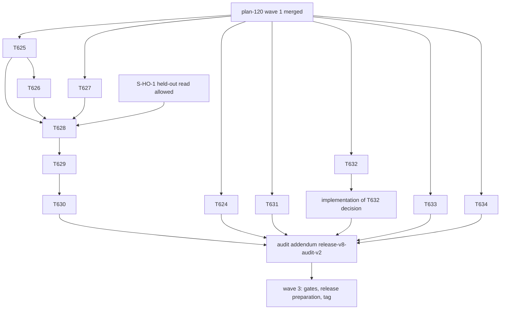

# plan-121 — Release v8.0.0, wave 2: apply the decided edits, earn the promotions, close the audit concerns

**Created:** 2026-10-14
**Based on:** `docs/plans/plan-120-release-v8-readiness.md` (wave 1: T619-T623);
`docs/artifacts/remaining-observations-ruling-v1.md` (T621); `docs/artifacts/promotion-and-golden-realignment-plan-v1.md` (T622);
`docs/artifacts/release-v8-audit-v1.md` (T623, concerns C-1..C-9); `docs/artifacts/security-review-t619-release-job-v1.md`;
the user's answers of 2026-10-14 (AskUserQuestion, verbatim option labels): T621 group A "Apply O4-a, O1-a, O2-a, O6-a (Recommended)";
group B "Scope = PoC root, every text file (Recommended)"; group C "Adopt the bug-report mapping (Recommended)";
T622 Q1 "tech-lead at v21, orchestrator after v8.0.0 notes (Recommended)"; Q2 "Run it now, I'll supply the workflow (Recommended)";
Q2 part 2 "Yes, amend (Recommended)"; Q3 "Yes, that one case only (Recommended)"; G-1 "Approve G-1 and baseline v21 (Recommended)".
Earlier (2026-10-09): "approving baseline v21 - plan re-evaluation and steps to bring them out of experimental".
**Scopes:** `T624`, `T625`, `T626`, `T627`, `T628`, `T629`, `T630`, `T631`, `T632`, `T633`, `T634`.

## Goal

Reach a `develop` from which the release gates for v8.0.0 can run: the decided knowledge edits are applied, `tech-lead` is promoted
under evaluator baseline v21 (and `orchestrator` is staged behind the v8.0.0 release notes), the audit's adopter-documentation and
release-tooling concerns are closed, and the release-level security audit has covered the installer. The release itself (version bump,
`docs/releases/v8.0.0.md`, tag, merge to `main`) is wave 3 and needs the user's explicit approval at each outward-facing step.

## Task Decomposition

1. **T624** — Apply the T621 rulings: A1 (O4-a, O1-a, O2-a, O6-a), B1 (O5-a), C1 (O8-a, the `bug-report.md:54` mapping as an agreement rule in `gitlab-management`). Six fences in five files; about 33 root-drift paths declared. *Acceptance:* every Before replaced exactly once with its held After; byte-unchanged list respected; all gates and the full suite pass; no root refresh.
2. **T625** — A full `/code-review` of the T619 MR by `@tech-lead` (steps 8-9 artifact versions and the `## VERDICT` block with every field of `code-review.md:38-49`), stored as an immutable artifact `docs/artifacts/code-review-t619-v1.md`. The author is the agent to be promoted; the public `/code-review` text is the only guide. *Acceptance:* artifact merged by MR; no held-out id or case predicate is shown to the author.
3. **T626** — Independent check of T625's artifact against `code-review.md` by `@qa-engineer` (every field present, enums valid, artifact versions referenced). *Acceptance:* a pass/fail record naming each field; a failed field returns the artifact to T625.
4. **T627** — A real `/skillify` interview run with the user (the orchestrator runs the four rounds; the user supplies the workflow and approves the draft), producing one skill under `implementation/knowledge/skills/<name>/SKILL.md`; sync and registry regenerated; the template fix (`maturity: experimental`, user-approved) applied to the command. *Acceptance:* the skill passes `skill.schema.json`; gates pass. **Blocked on the user's workflow.**
5. **T628** — Golden realignment A under grant G-1 (`protected-paths-v1.md` §5; the user approved G-1 and baseline v21): items 1-10 always, item 11 if T627 is merged, item 12 (the one held-out `/code-review` case, by predicate) only after the orchestrator's S-HO-1 read allowed it. Every `expect.py` check byte-identical except the prepare-release path lines; discrimination probes on scratch copies; scorecard regenerated. *Acceptance:* the T622 plan §6.3 controls, reported item by item; exactly the two evaluator-hash failures in the suite, named.
6. **T629** — Baseline v21: `evaluator-hash-known-good-v21.json` per the T622 plan §7 (independent second computation in a fresh worktree), repoint `evaluator_hash.py`, keep `reason` text free of held-out ids. *Acceptance:* hash check passes at v21 and fails on a tampered copy; scorecard counts as expected (28/6 after T628 without `/skillify`, 29/5 with it).
7. **T630** — Promote `tech-lead` to `stable` (`maturity:`, distribution snapshot at `tests/functional/test_check_maturity.py`, registry and mirrors) if and only if T629 cleared its blocker; independent re-run of `check-maturity.py` by a reviewer other than `tech-lead`. *Acceptance:* `check-maturity.py` 0 failing; maturity distribution recorded.
8. **T631** — Adopter documentation for the new surface (audit C-7): `--projections-only`, `poc-security-audit`, the client-owned allow rule `mcp__poc-security-audit__*`, the Python `mcp` dependency and `git >= 2.40`, in `README.md`, `docs/wiki/*`, `implementation/README.md` and `implementation/SECURITY.md`. *Acceptance:* each new flag, server and requirement documented once and consistently; no stale version marker introduced.
9. **T632** — Decision (solution-architect): the release documents that disagree (audit C-2, C-4): `verify-release-docs.py` against `release-workflow` § 4, `/prepare-release`, the orchestrator preflight and `docs/releases/_template.md`; the tag and back-merge ordering against the main-develop drift gate. One consolidated user question; implementation follows as a separate task. *Acceptance:* one artifact with a disposition per disagreement and held amendments.
10. **T633** — Release-level Security Engineer audit of `scripts/install.sh`, `merge-mcp-json.py`, `merge-task-docs.py` and the PoC scanner (audit C-6): OWASP run, findings graded. *Acceptance:* a verdict and findings table recorded as an artifact; any `SECURITY:HIGH` blocks the release.
11. **T634** — Superseding note for ADR-008's contradictory status block (audit C-8): accepted ADRs are immutable, so a superseding note or a new ADR-008 successor records the accepted status; plus a single reference table of the coexisting severity scales. *Acceptance:* the status contradiction no longer exists in the current text; no accepted text edited in place.

## Dependency Graph

Parallel from the start: T624, T625, T627, T631, T632, T633, T634. Serial chain: T625 -> T626 -> T628 -> T629 -> T630. `T627` and the S-HO-1 permission are external inputs to T628.

## Resource Assignments

| Task | Agent | Notes |
|---|---|---|
| T624 | backend-developer | Verbatim fences; Security Engineer review of the agent-text projections is not required (notes only) |
| T625 | tech-lead | Review mode; writes one artifact |
| T626 | qa-engineer | Independent of T625's author |
| T627 | orchestrator with the user | Needs the user's workflow; the draft is the user's to approve |
| T628 | qa-engineer | The only task authorized to touch `tests/golden/**`; commits, never refreshes the baseline |
| T629 | orchestrator | After independent verification |
| T630 | backend-developer | Reviewed by `solution-architect` or the top-level session, not by `tech-lead` |
| T631 | technical-writer | No shell: the orchestrator commits |
| T632 | solution-architect | Decision only |
| T633 | security-engineer | Read-only audit |
| T634 | solution-architect | No shell: the orchestrator commits |

## Risk Assessment

| Task | Complexity | Risk | Mitigation |
|---|---|---|---|
| T624 | S | Anchor drift in five files | Whole-line asserts; stop on a missing or non-unique anchor |
| T625 | S | The author reviews a component of its own release; a review that reads as boilerplate | QA check (T626); the review must cite the MR's actual diff |
| T626 | S | Rubber-stamping | Per-field table |
| T627 | M | Needs user input; a skill that is not honestly useful | The user chooses the workflow and approves the draft |
| T628 | M | Weakening a test to force a pass; leaking a held-out id | `check()` byte-identical; discrimination probes; held-out hygiene rules of the T622 plan §9 |
| T629 | S | A wrong digest or an undeclared change | Independent second computation; tamper test |
| T630 | S | Promoting before the blocker is truly cleared | Depends on T629; `check-maturity.py` re-run by another reviewer |
| T631 | M | Docs drift from the shipped behaviour | Check each claim against `install.sh` and the contract |
| T632 | M | A tier-1 conflict inside the release documents | Escalate under P5 as a question |
| T633 | L | The installer is large (765 changed lines); a finding late in the process | Start now; grade findings; HIGH blocks |
| T634 | S | Editing an accepted ADR | Superseding note only |

## Open Questions

1. **S-HO-1 (blocking T628 item 12 and therefore T630):** the auto-mode permission check blocked the orchestrator's read of the single held-out `/code-review` case that the user authorized in chat. The user decides: add a Bash permission rule for that read, do the read and answer three questions (would a review following the public `/code-review` text satisfy the check; command-text defect or omission; ADR-007 branch), or drop `tech-lead`'s promotion. Until then T628 items 1-11 and T629 can proceed; item 12 and T630 wait.
2. **T627:** the user supplies the workflow for the `/skillify` run (suggestion only: the GitLab API fallback for the branch and tag steps).
3. **G-2 and baseline v22** (orchestrator promotion after the v8.0.0 notes exist) are drafted later and need a separate approval; they are not part of this plan.
4. Is the T623 audit addendum (`release-v8-audit-v2.md`) produced after wave 2 by the same Tech Lead, given that `tech-lead` is itself being promoted? (Default: yes, with the conflict recorded in the sign-off.)
5. Wave 3 (gates, release preparation, tag, merge to `main`) is a separate plan; each outward-facing step needs the user's explicit approval.

## Constraints

- Golden files and `scripts/scorecard.py` change only under G-1 and the new baseline; no held-out id appears in any brief, report, commit message, branch name, ledger row or file outside `tests/golden/`.
- A command changes only by the user's decision (all command edits here were decided: `/skillify` template `maturity`, and none other).
- Maturity is never relied on to rank a conflict (ADR-008 P4).
- No task row for T624-T634 exists until this plan is merged and the user has approved it (`/plan` Task Creation Precondition).

## Addendum (2026-10-14): T635

The Tech Lead's `/code-review` of the T619 change (T625, `docs/artifacts/code-review-t619-v1.md`) returned `CONDITIONAL_PASS` with three Should Fix conditions for the release job, due before the Release gate for v8.0.0. **T635** (devops-engineer, depends on T625) resolves them and the cheap Nice-to-Have items. It joins the wave-2 chain ahead of the release gates; it adds no new decision.

## Addendum 2 (2026-10-14): T636 and T637

The release-level Security Engineer audit (T633, `docs/artifacts/security-review-release-v8-v1.md`) returned `CONDITIONAL_PASS` with three medium findings that block the release (`validation-gates` § Verdict Rules). The user decided on 2026-10-14: SEC-001 (the installer follows symlinks at managed paths; reproduced by the orchestrator) is fixed before the release: **T636** (backend-developer). SEC-002 (four MCP server entries launch npm packages that do not exist, present since v7.0.1, and the `npx` entries are unpinned) is fixed before the release in two steps: **T637** (devops-engineer) researches and proposes the exact names and pins, which come back to the user; a later task applies them and refreshes the root. SEC-003 (release token in argv) is stated by the user to be Protected and Masked with the `v*` tag pattern protected, so it stays technical debt. Both tasks join the wave-2 chain ahead of the audit addendum (`release-v8-audit-v2`) and the release gates.
