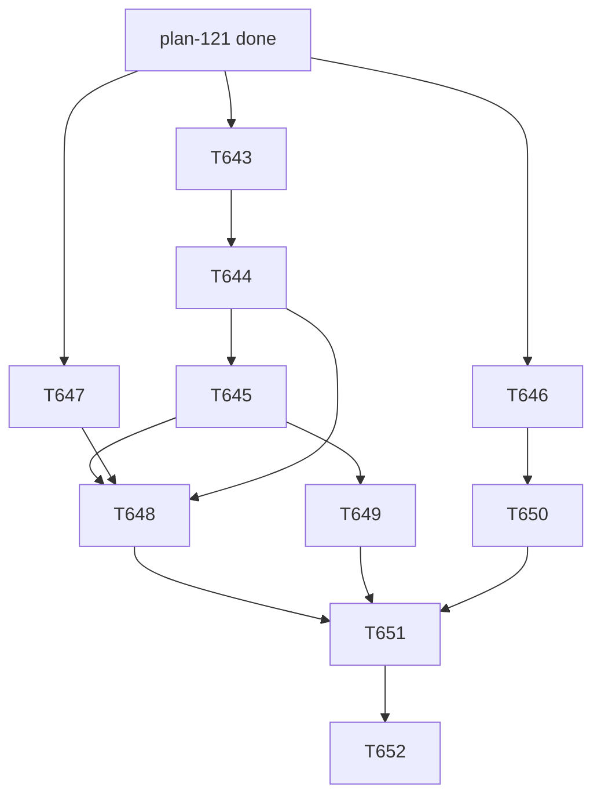

# plan-122 — Release v8.0.0, wave 3: prepare, gate, publish

**Created:** 2026-10-15
**Based on:** `docs/plans/plan-121-release-v8-wave-2.md` (wave 2, done); `docs/artifacts/release-v8-audit-v2.md` (T641: dispositions of C-1..C-9, Migration M-1..M-9, Known issues K-1..K-14, decisions D-1..D-7, §9 recommended order); `docs/artifacts/release-documents-ruling-v1.md` (T632: union contract, develop-first order, document-only release body); `docs/artifacts/security-review-release-v8-v1.md` (T633).
The user's answers (AskUserQuestion, verbatim option labels): 2026-10-09 "1. A 2. A 3. A 4. approving baseline v21 ... 5. C 6 B"; 2026-10-15 T632 group B "B1: develop, then main, then tag (Recommended)"; D-1 "Exclude tests/golden/ (Recommended)" (done, T642); D-3 "In the v8.0.0 notes only"; D-5 "Image run, no publish (Recommended)"; T627 "Run it now (Recommended)" (done).
**Scopes:** `T643`, `T644`, `T645`, `T646`, `T647`, `T648`, `T649`, `T650`, `T651`, `T652`.

## Goal

Publish `v8.0.0` safely: a `release/v8.0.0` branch with the version markers and the stale claims fixed, one release document `docs/releases/v8.0.0.md` built from audit v2 §3-§6, the full gate sequence (QA gate, Tech Lead review by area, release-level security re-check, release-manager verdict), a rehearsal of the release job's git commands in the real CI image without publishing, then the merge to `develop`, the merge to `main` and the tag. Every outward-facing step (opening the release MRs, the merge to `main`, creating the tag) needs the user's explicit approval at that moment; nothing in this plan pre-approves one.

## Task Decomposition

1. **T643** — Root refresh 18 (`scripts/install.sh --projections-only` in a clean worktree), clearing the 20 declared drift paths of T627 so the release starts with drift 0. *Acceptance:* the drift baseline is empty and the parity test passes. **Needs the user's approval of the refresh.**
2. **T644** — Open `release/v8.0.0` from `develop` (or from the T643 result); bump the four version markers (`README.md:14`, `docs/wiki/README.md:6`, `docs/wiki/home.md:5`, `implementation/README.md:6`) and fix the other stale lines of audit v2 C-1 (`README.md:201`, `docs/wiki/implementation-guide.md:5` and `:41`, `implementation/README.md:4` and `:56`); update the stale component counts that the audit lists (27 agents, 18/16 commands, "two remote servers", the manual-copy tables without `implementation/runtime/`). *Acceptance:* `scripts/check-version-consistency.py` passes at v8.0.0; no other file changed.
3. **T645** — Write `docs/releases/v8.0.0.md` from template `_template.md` and audit v2 §3-§6 (Migration M-1..M-9 including the SEC-002 note for v7.x installs, Known issues, the `tech-lead` maturity change, the sign-off conflict disclosure), with the `RELEASE VERDICT` counting rule (D-2) and the rollback label (D-6) decided by the release manager. *Acceptance:* `scripts/verify-release-docs.py --tag v8.0.0` passes; repository files are code spans or absolute URLs (the gate link-checks relative links).
4. **T646** — Dependency audit of the pinned MCP set and `mcp==2.2.0` (audit D-7), by the Security Engineer with the audit tools available. *Acceptance:* a recorded result per package or an explicit "tool could not run, reason"; any `SECURITY:HIGH` blocks.
5. **T647** — Rehearse the release job's git commands in the real CI image, no publish (audit D-5, the user chose "Image run, no publish"): `docker run python:3.12-alpine` with `apk add git` on a scratch clone of the release branch, running `scripts/publish-release.py --skip-api` with a fake tag in a scratch repository, confirming `git log --no-merges --end-of-options <rev> --`, tag listing and the generated `CHANGELOG.md`. *Acceptance:* output recorded; nothing is created on GitLab.
6. **T648** — QA release gate: the full suite, the golden suite and scorecard, `verify-release-docs.py`, `check-version-consistency.py`, `check-main-develop-drift.py` (offline), a clean install into a scratch target (`install.sh` plain and `--projections-only`), and the Migration steps replayed on a scratch v7.x-shaped target. *Acceptance:* verdict `PASS | CONDITIONAL_PASS | FAIL` in the gate-verdict form.
7. **T649** — Tech Lead review by area (installer and tooling; knowledge text and rulings; CI and release job; documentation), read-only, disclosing that `tech-lead` is itself promoted in this release (audit v2 §8). *Acceptance:* a verdict per area in the gate-verdict form.
8. **T650** — Release-level security re-check: the delta since T633 (T636 symlink guard, T638 MCP entries and pins, T640 release body, T642) plus T646's result; confirm SEC-002 is closed in the shipped configs and the M-9 note is accurate. *Acceptance:* a verdict; any `CRITICAL` or `HIGH` blocks.
9. **T651** — Release manager verdict: read all gate verdicts, issue the `## RELEASE VERDICT` block (counts per the counting rule), complete `## Gate Verdicts`. *Acceptance:* `verify-release-docs.py` passes with the verdict in place; the `Release` line equals the `Status`.
10. **T652** — Publish (orchestrator, each step needs the user's explicit approval at that moment): MR `release/v8.0.0` to `develop`; MR `develop` to `main` with merge commits, no squash; tag `v8.0.0` on the verified `main` tip; watch the three tag jobs; write `docs/checkpoints/checkpoint-038-release-v8.0.0.md`; the post-release step (G-2 and baseline v22 for the `orchestrator` promotion and the `/skillify` golden case) is a separate plan. *Acceptance:* the GitLab Release exists with the document as its body and `CHANGELOG.md` is generated.

Parallel from the start: T643, T646, T647. Serial: T643 -> T644 -> T645 -> (T648, T649, T650) -> T651 -> T652.

## Resource Assignments

| Task | Agent | Notes |
|---|---|---|
| T643 | orchestrator | Needs the user's approval; clean worktree; no agent edits derived folders |
| T644 | release-manager | On `release/v8.0.0`; version bump scope only |
| T645 | release-manager | No shell needed beyond the gate scripts; the technical-writer has no shell, so the release manager writes and commits |
| T646 | security-engineer | Read-only audit |
| T647 | devops-engineer | Local docker; no GitLab writes; no tag, no release |
| T648 | qa-engineer | Test files only |
| T649 | tech-lead | Read-only review |
| T650 | security-engineer | Read-only review; the orchestrator records it |
| T651 | release-manager | Issues the verdict only after T648-T650 |
| T652 | orchestrator | Each outward-facing step needs the user's explicit approval; subagents never merge or tag |

## Risk Assessment

| Task | Size | Risk | Mitigation |
|---|---|---|---|
| T643 | S | The refresh changes the user's local files | Clean worktree; `--projections-only`; the user's local `.vscode/mcp.json` and `.claude/settings.json` are not touched |
| T644 | S | A missed stale line fails Gate G0 on the tag | Re-run `check-version-consistency.py` at v8.0.0 on the final tree |
| T645 | M | Three documents disagreeing about the release document (resolved by T639) | Build from the template; run `verify-release-docs.py` |
| T646 | S | No audit tool covers the npx/uvx entries | Record "not covered" explicitly; do not claim a clean result |
| T647 | S | The image run differs from the real job (token, API) | State the limit; the API calls are covered by the offline dry run |
| T648 | L | A failing gate late in the sequence | Run the cheap gates first; fix tasks via the orchestrator |
| T649 | M | Reviewer conflict (`tech-lead` promoted here) | Disclose in the verdict; the orchestrator's independent re-run (T630) is recorded |
| T650 | M | A late HIGH finding | Grade; a HIGH blocks and returns to a fix task |
| T651 | S | The verdict issued before all gates | Depends on T648-T650 |
| T652 | M | The push auth failure and a tag job failing | Commits API fallback (skill `gitlab-api-push-fallback`); the user approves each step; the tag is never moved or deleted |

## Open Questions

- The `RELEASE VERDICT` counting rule (D-2) and the rollback label (D-6): the release manager decides in T645; the user sees both in the release document.
- The user's check of `WIKI_TOKEN` (Protected and Masked) and the `v*` tag protection (D-4) before T652; the Release Manager records the user's answer in the document's Gate Verdicts.
- Whether to run T643 (root refresh 18) before the release branch is cut: recommended yes (drift 0 at the tag).

## Constraints

- Subagents never merge, never create or push a tag or a release, never use `WIKI_TOKEN`; the orchestrator merges only on `mergeable` with a green pipeline and a pinned sha.
- Never open `tests/golden/held-out/`; never write a held-out id; no `.env*` or credential files; the user's local `.claude/settings*.json` and `.vscode/mcp.json` are not read or edited.
- `git push` may fail: use the Commits API fallback (skill `gitlab-api-push-fallback`) and verify the tree.
- Task rows are created only after this plan is merged and the user has approved it.

## Addendum (2026-10-15): T653

T646 (the dependency audit, `docs/artifacts/security-review-t646-dependency-audit-v1.md`) graded one finding SECURITY:MEDIUM (SEC-T646-01, `mcp-fetch-server@1.1.2`: the redirect target is checked after the request; the guard depends on an unpatched `private-ip`). A medium finding must be fixed or re-graded on evidence before the release ships. The user chose, by AskUserQuestion on 2026-10-15, the option "Test first, then decide (Recommended)".

11. **T653** — Loopback redirect test of the pinned `mcp-fetch-server@1.1.2` (devops-engineer): server A on loopback answers 302 to server B on another loopback port; does B see a request? Scratch directory outside the repository; loopback and the npm registry only; one artifact `docs/artifacts/fetch-ssrf-test-t653-v1.md`. *Acceptance:* results for four cases with B's request log and the statement "B saw a request after a redirect: yes/no". If no, SEC-T646-01 is re-graded LOW (tracked debt). If yes, the MEDIUM stands and the fix options (move `fetch` to `extended`, remove it, replace it) go to the user before T650. T650 (security re-check) depends on T653 as well.

## Addendum 2 (2026-10-15): T654, T655

T653 (`docs/artifacts/fetch-ssrf-test-t653-v1.md`) confirmed SEC-T646-01: with `mcp-fetch-server@1.1.2` a redirect to a loopback address is requested before it is rejected, so the MEDIUM stands and must be fixed before the release. The user decided, by AskUserQuestion on 2026-10-15 (free-text answer, quoted): "Remove the fetch server and replace it by an alternative (i.e Playwright MCP Server (microsoft/playwright-mcp)) which you evaluate first. Replace it before Release".

12. **T654** — Evaluate `@playwright/mcp` as the replacement, hands-on (devops-engineer): coverage of the 11 agents that list `mcp__fetch`, the origin-restriction flags and glob syntax in the pinned 0.0.83, a loopback redirect test with and without `--blocked-origins`, the browser prerequisite, and a recommendation with exact `args`. Playwright MCP is already installed in every install without origin restrictions, so the evaluation states what it can reach today. *Acceptance:* artifact `docs/artifacts/fetch-replacement-evaluation-v1.md`; nothing in the install changes.
13. **T655** — Implement (devops-engineer): remove the `fetch` entry, apply the evaluated hardened `playwright` entry, update the 11 agents' tool lines, AGENTS.md, the wiki, PREREQUISITES and the pin tests; regenerate mirrors and registry; declare the root drift. *Acceptance:* all gates and the suite pass; no `mcp-fetch-server` or `mcp__fetch` outside historical records. Dispatched only after the orchestrator has recorded the evaluation's recommendation as accepted in the T655 brief; if the evaluation finds Playwright unsuitable, the question returns to the user.

T650 (security re-check) now depends on T655; a further root refresh and a merge of `develop` into `release/v8.0.0` follow T655.

## Addendum 3 (2026-10-15): T656

The T655 security review (`docs/artifacts/security-review-t655-fetch-removal-v1.md`, CONDITIONAL_PASS: 3 medium, 7 low) named conditions and cheap fixes. The user's standing decision of 2026-10-09 ("5. C": fix every residual before the release) applies.

14. **T656** — Fix the T655 review findings that can be fixed in the repository now (devops-engineer): SEC-T655-01 (replace the whole-server grant `mcp__playwright` of qa-engineer, frontend-developer, poc-qa-engineer and demo-agent by named non-"unsafe" Playwright tools, after testing that per-tool names are honoured in each of the seven projections; where a platform cannot express them, stop and report instead of shipping a half-measure; add a test that pins the grant set), SEC-T655-02 (document that the shipped entry blocks local-app URLs and add a documented user-owned `playwright-local` pattern), SEC-T655-04 (sync.mjs: throw on a backslash inside a quoted item and on an unclosed quote, plus a test comparing the reader with `yaml.safe_load` for every entry), SEC-T655-05 (PREREQUISITES leads with the pinned `install-browser` command and states sizes and what is verified), SEC-T655-08 (document `.playwright-mcp/` for installed projects), SEC-T655-09 (the four documentation nits), SEC-T655-10 (the missing tests incl. `--force-prune-keys fetch`). SEC-T655-03 (root refresh) is the orchestrator's after T656; SEC-T655-06 and SEC-T655-07 stay tracked debt. *Acceptance:* all gates and the suite pass; the grant-set test fails if a Playwright grant is added to the ten agents or the whole server is re-granted to the four; a Security Engineer review of the diff follows; T650 depends on T656.

## Addendum 4 (2026-10-15): T657

T656 fixed items 2 to 7 of the T655 review follow-up and stopped on SEC-T655-01 (narrowing the four agents' whole-server `mcp__playwright` grant): the generator copies tool names verbatim, and the platforms use different name forms (Claude Code `mcp__server__tool`, Copilot `server/tool`, Opencode `server_tool`; Gemini drops the tools line, Cline has no agent files, Pi has no native MCP; Cursor unverified). The user chose, by AskUserQuestion on 2026-10-15, the option "Build the mapping now (T657)".

15. **T657** — Per-platform MCP tool-name mapping and narrowed Playwright grants (devops-engineer): add a mapping from the source form `mcp__<server>__<tool>` to each platform's documented form in the generator (`implementation/scripts/sync.mjs` and the platform manifests), applied to the already-shipped `mcp__security-audit__*`, `mcp__poc-security-audit__*`, `mcp__gitlab` and `mcp__playwright` lines only where the platform's documentation says the current form is not honoured; then replace the whole-server `mcp__playwright` of qa-engineer, frontend-developer, poc-qa-engineer and demo-agent by named non-"unsafe" tools. Every platform's behaviour is established from its current documentation (`npx ctx7@latest`) or marked unverified; an unverified platform keeps its current rendering and is reported, not guessed. *Acceptance:* a unit test of the mapping per platform; the grant-set test (T656) extended to fail if the whole server is re-granted to the four; all gates and the suite pass; the root drift declared; a Security Engineer review of the diff follows; T650 depends on T657.

## Addendum 5 (2026-10-15): T658

The T657 security review (`docs/artifacts/security-review-t657-tool-name-mapping-v1.md`, CONDITIONAL_PASS) kept SEC-T657-01 (MEDIUM): the narrowed Playwright grants are not in force on Opencode, Gemini CLI and Cursor. The user chose, by AskUserQuestion on 2026-10-15, the option "Implement Opencode deny + Gemini excludeTools first", and approved root refresh 19 ("Yes, refresh (Recommended)"), which now runs after T658 so that the root is refreshed once.

16. **T658** — Server-level denial of the six excluded Playwright tools (`browser_run_code_unsafe`, `browser_evaluate`, `browser_file_upload`, `browser_drag`, `browser_drop`, `browser_network_request`) where the platform documents one, emitted by the generator (devops-engineer): Opencode (a `permission` deny for the six tools, in the generated Opencode config or the agent files, whichever the Opencode documentation says is enforced and survives the install merge) and Gemini CLI (`excludeTools` on the generated `playwright` mcpServers entry, which the Gemini documentation says takes precedence over `includeTools`). Cursor stays a Known issue (no documented control). Documentation, source and vendor repository evidence per platform in a new artifact `docs/artifacts/mcp-server-denials-v1.md`; an unverified mechanism is not shipped. *Acceptance:* generator tests for both platforms; the install merge keeps the denial and does not clobber a user's own `permission`/`excludeTools`; the grant-set test extended; all gates and the suite pass; the root drift declared; a Security Engineer review of the diff follows; T650 depends on T658 (and the root refresh T659 depends on it).
17. **T659** — Root refresh 19 (orchestrator), after T658 merges: `scripts/install.sh --projections-only` in a clean worktree; approved by the user on 2026-10-15 ("Yes, refresh (Recommended)").
