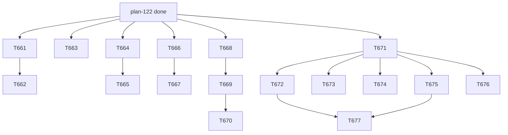

# plan-123 — Post-release follow-ups after v8.0.0

**Created:** 2026-10-16
**Based on:** `docs/checkpoints/checkpoint-038-release-v8.0.0.md` (section 3, the follow-up list); `docs/releases/v8.0.0.md` (Known issues K-15, K-16, K-18); `docs/artifacts/security-review-release-v8-v2.md`, `security-review-t658-server-denials-v1.md`, `security-review-t660-gitlab-grants-v1.md`, `code-review-release-v8-v1.md`, `qa-gate-release-v8-v1.md`; `docs/artifacts/promotion-and-golden-realignment-plan-v1.md` §6.4 (grant G-2) and §7 (baseline procedure); `docs/plans/plan-122-release-v8-wave-3.md`.
The user's words (2026-10-16, verbatim): "Regarding the first point "The fixable parts of SEC-T658-01: Opencode per-agent denies and a Cursor CLI deny list.": I want to drop Cursor support completely" and "Regarding baseline v22: approving it". Earlier decisions that stay in force (2026-10-15, AskUserQuestion option labels): SEC-T658-01 "Accept the unfixable remainder; fix the rest after v8.0.0 (Recommended)"; SEC-T660-01 "Accept the risk, plan after the release (Recommended)"; the standing decision of 2026-10-09 "5. C" (fix every residual).
**Scopes:** `T661`, `T662`, `T663`, `T664`, `T665`, `T666`, `T667`, `T668`, `T669`, `T670`, `T671`, `T672`, `T673`, `T674`, `T675`, `T676`, `T677`.

## Goal

Close the follow-ups that v8.0.0 shipped with: (1) the tool-restriction residual (Opencode per-agent denies; Cursor support is dropped, which removes the Cursor part of SEC-T658-01 instead of fixing it); (2) the GitLab credential and grant work (SEC-T660-01 token scope and environment handling; named GitLab tool sets for the remaining roles, SEC-T660-04); (3) the promotion of `orchestrator` and the move of the `/skillify` golden case under grant G-2 and evaluator baseline v22 (approved by the user on 2026-10-16); (4) the tracked low-severity debt, consolidated into a register and worked off in themed tasks. The result is a v8.x release (the version, and whether the Cursor removal makes it a MAJOR bump, is decided by T661 and the user, not here).

## Task Decomposition

1. **T661** — Decision (solution-architect): drop Cursor support completely. An ADR (`docs/decisions/ADR-010-*.md`) and an inventory artifact listing everything Cursor touches: `implementation/platforms/cursor.json`, `implementation/.cursor/`, the root `.cursor/`, `install.sh` and `sync.mjs` platform handling (`--platform cursor`, `all`), generators, tests (platform conformance, projections, tool-name mapping, denials, root parity, drift baseline), docs (README, wiki, setup pages, `AGENTS.md` platform lists), the registry and MCP configs, release-workflow and release-document templates (the install table), and any `tests/golden/**` case that mentions Cursor (protected: needs a grant). It states what `install.sh --update` does with an existing `.cursor/` in an adopter's project (leave it, or remove it with a notice), the version impact (removing a supported platform is a breaking change under the project's own rules: MAJOR or a deprecation cycle), the Cursor residuals that disappear (K-15, SEC-T658-01 remainder, SEC-T650-02) and the user-facing migration text. *Acceptance:* the ADR with options and a recommendation, the inventory, and the user's decision on version and migration behaviour. **Decision only; the user decides.**
2. **T662** — Implement the ADR-010 outcome (devops-engineer, with technical-writer for the docs): remove Cursor from the source tree, generators, installer, tests, docs, registry and root install per the inventory; regenerate; declare the root drift. *Acceptance:* no Cursor references remain outside historical records and the migration note; all gates and the suite pass; a Security Engineer review follows. Depends on T661. If the inventory shows `tests/golden/**` edits are needed, T662 stops at that point and the orchestrator brings a grant (G-3) to the user; those goldens are then folded into a later baseline.
3. **T663** — Opencode per-agent denies (devops-engineer): the fixable part of SEC-T658-01 for the one platform that documents it. The generator emits per-agent `false` entries so that an agent that does not hold a tool cannot call it: the six excluded Playwright tools for every agent, and the GitLab write tools for every agent that does not hold the GitLab server. The mechanism is first established from the Opencode documentation and vendor source (the T658 artifact `mcp-server-denials-v1.md` recorded that a per-agent `false` is the only form that survives a broader allow written later in the same agent); an unverified mechanism is not shipped. Also addresses SEC-T657-04 (the generated `x: true` entries override a user's own `ask`/`deny`). *Acceptance:* generator tests, install-merge tests, the grant-set tests extended; all gates and the suite pass; a Security Engineer review follows.
4. **T664** — Design (solution-architect): token scope and environment handling for `GITLAB_PERSONAL_ACCESS_TOKEN` (SEC-T660-01). Options: the minimum PAT scopes per use (read-only versus write), separate tokens per use, keeping the token out of the agents' shell environment (a launcher that starts only the MCP server with the token, an OS keychain or a secret file read by the server), what each client supports, what it costs adopters. *Acceptance:* an artifact with options, a recommendation and the user's decision. **Decision only.**
5. **T665** — Implement the T664 decision (devops-engineer; technical-writer for `PREREQUISITES.md` and the wiki). Depends on T664. *Acceptance:* per the decision; tests; a Security Engineer review.
6. **T666** — Named GitLab tool sets for `orchestrator` and `poc-orchestrator` (devops-engineer), the weakest fit among the five whole-server holders (they read untrusted issue, MR and subagent text and hold `execute` and `agent`): read the roles, take the exact tool names from the pinned `@zereight/mcp-gitlab@2.2.5`, least privilege (no merge, push, delete, branch/tag/release creation, pipeline trigger; the top-level session merges after independent verification). The tool-name mapping renders them per platform; `GitLabGrantSetTests` pins them. *Acceptance:* tests, gates, a Security Engineer review.
7. **T667** — Named GitLab tool sets for `devops-engineer`, `release-manager` and `poc-devops-engineer` (devops-engineer), after T666 proved the pattern; the project rule is that subagents never merge, so the sets exclude merge unless the role body demands it and the user agrees. Depends on T666.
8. **T668** — Golden realignment B under grant **G-2** (qa-engineer), approved by the user together with baseline v22 (see "Grant G-2" below). Items: (1) the open `prepare-release-real-verdict-missing` case: `status: expected_pass`, drop the two `known_failing_*` keys, replace its fixture `fixture/docs/releases/v7.0.1.md` by a byte-identical copy of the now-published `docs/releases/v8.0.0.md`, rewrite the brief's history sections; `expect.py` unchanged since G-1; (2) the open `skillify-skill-file-template-drift` case (item 11 of G-1, deferred): `status: expected_pass`, drop the two `known_failing_*` keys, replace the fixture by a byte-identical copy of the generated skill `implementation/knowledge/skills/gitlab-api-push-fallback/SKILL.md` at `fixture/implementation/knowledge/skills/gitlab-api-push-fallback/SKILL.md` (one of the declared skill roots of `expect.py`), delete the old fixture file, rewrite the brief's history sections; `expect.py` unchanged. Controls as in G-1: `check()` byte-identical, before/after results, discrimination probes on scratch copies, scorecard before (34 / 28 / 0) and after, the floor check, gates, held-out hygiene (no held-out id anywhere). *Acceptance:* the G-1 control list, reported item by item.
9. **T669** — Evaluator baseline **v22** (orchestrator): the procedure of the promotion plan §7 with every "21" read as "22" (two independent digest computations, a new `evaluator-hash-known-good-v22.json`, `DEFAULT_KNOWN_GOOD_PATH` repointed, a `reason` without held-out ids). Depends on T668. *Acceptance:* hash check passes at v22 and fails on a tampered copy; scorecard counts as expected; the suite passes.
10. **T670** — Promote `orchestrator` to `stable` (backend-developer), steps 1 to 7 of the promotion plan §10: the `maturity:` line, the distribution snapshot in `tests/functional/test_check_maturity.py` (after both promotions the `agent/experimental` line disappears; the report prints a tier only when it has members), registry and mirrors, drift declared; an independent re-run of `check-maturity.py` by a reviewer other than the agent promoted (the top-level session). Depends on T669.
11. **T671** — Tracked-debt register (tech-lead): consolidate every tracked low-severity item scattered across the review artifacts and the release document into one register `docs/artifacts/tracked-debt-register-v1.md` (id, source artifact, grade, location, one-line description, proposed disposition: fix in T672 to T677, fix elsewhere, accept, close as obsolete). Sources include the T633 findings SEC-004 to SEC-015, T636 L6 and L7, T619 and T620 residuals (SEC-T619-05, the T620 JWT and scanner items), T635 SEC-T635-01 to -04, T640 SEC-T640-01 to -04, T646 SEC-T646-02 to -06, T650 SEC-T650-02 to -05, T655 SEC-T655-04 to -10, T657 SEC-T657-04, -07, -09, T658 SEC-T658-02 to -07, T660 SEC-T660-02 to -07, TL-T649-01 to -20, QA-T648-01 to -04, the T621 observations, the T634 severity-scale reference page that was never created, stale component counts in README and wiki, and the plan-112 parked notes. Items already fixed are marked closed with the evidence. *Acceptance:* the register; every id in the release document's K-18 appears in it.
12. **T672** — Installer and generator robustness (devops-engineer): SEC-T658-05 (a plain install without `--update` overwrites existing `.opencode/opencode.json` and `.gemini/settings.json`; invalid JSON in a user's config gives a traceback after the platform tree was replaced, so validate the destination before the tree sync and print a clear message; a one-line stderr note when a user value is replaced; an end-to-end `--projections-only` test), SEC-T658-07(b) / TL-T649-03 (validate all manifests before the first write), TL-T649-04 (`splitInlineArray` rejects trailing commas, empty arrays and `a: b` or `{}` items), TL-T649-06 (indentation, unbound-variable messages for a missing `--target`/`--platform` value), TL-T649-08 (`merge-task-docs.py` table bound), QA-T648-02 (the installer prints the Playwright browser step and the `.playwright-mcp/` advice).
13. **T673** — Test quality (qa-engineer): SEC-T657-07 (pin the non-Playwright grants; read-only roles hold no write MCP tool), SEC-T658-06 (anchor each documentation assertion to the paragraph it protects; remove the assertions that cannot fail), SEC-T660-06 (extend the forbidden-regex classes, assert Gemini agents carry no `tools:` line, assert the documented counts equal the lists), SEC-T655-10 leftovers.
14. **T674** — Documentation corrections (technical-writer; the orchestrator commits): SEC-T660-03 (list the operator controls `GITLAB_PERMISSION_MODE`, `GITLAB_DENIED_TOOLS_REGEX`, `GITLAB_ALLOWED_PROJECT_IDS`), SEC-T660-07 (the Pi omission and the default `core` toolset sentence), SEC-T655-09, SEC-T657-08, SEC-T658-03 and -04, TL-T649-10 (the `release-workflow` skill template title: a knowledge edit, so the projections change), the T634 severity-scale reference page `docs/wiki/severity-and-grade-scales.md`, stale component counts.
15. **T675** — CI and release tooling hardening (devops-engineer): SEC-T650-04 (pin the CI images by digest and `apk` packages), SEC-T650-05 (the `security-audit` tool root restriction so it can scan a worktree), SEC-T619-05 / SEC-003 (the token in argv: pass it by environment), SEC-T635-01 and -02 (`validate_api_target` as a URL parse with a host allowlist, a redirect-refusing opener), SEC-T635-03 and -04, SEC-T640-01 to -04 (symlink check in `load_release_brief`, `UnicodeDecodeError` handling, `previous_tag` against the tag regex, the host allowlist), TL-T649-05 (dry-run default `--tag`), TL-T649-07 (socket timeout handling), TL-T649-12 and -13 (the release-docs gate rejects `pending` and `YYYY-MM-DD` placeholders; the "main merged before the tag" duty), the `update_changelog` intro-paragraph placement (K-12).
16. **T676** — Supply-chain and verification checklist items (security-engineer review; devops-engineer implements): SEC-T646-03 (prefer versions with npm provenance at each pin bump), SEC-T646-04 (the `httpx2>=2.12.0` floor or a constraints file), SEC-T646-05 (a working audit path for the `npx` entries, for example a throwaway `package.json` generated from the pins), SEC-T646-06 (read advisory ranges manually for the three reference servers that moved from calendar versions), SEC-T655-06 (a browser security-version check in the pin-bump checklist), SEC-T655-07 (the optional short additions to the blocked-origins list), SEC-T658-02 (a one-time manual check list for the Gemini and Opencode denials before the next release).
17. **T677** — Function-size refactors (devops-engineer): TL-T649-01 (`emitMcp` 117 lines, `syncPlatform` 130, `parseServersYaml` 62, `sync_tree_into` 76, `merge-mcp-json.py main` 63, `verify-release-docs.py main` 60 against the 50-line standard). Depends on T672 and T675 (the same files).

### Grant G-2 (golden task T668)

Authorized by this plan once the user approves it: modify only the two cases of T668 items 1 and 2 (their `case.yaml`, `brief.md` and `fixture/**`); not authorized: any `expect.py` change, any other golden file, `scripts/scorecard.py`, `evaluator_hash.py`, any `evaluator-hash-known-good-v*.json`, `tests/golden/README.md`, and the held-out directory (not opened by any task). The user approved baseline v22 on 2026-10-16 ("Regarding baseline v22: approving it"); T669 writes it as a new file after independent verification.

Parallel from the start: T661, T663, T664, T666, T668, T671. T662 waits for the user's ADR-010 decision; T665 for the T664 decision.

## Resource Assignments

| Task | Agent | Notes |
|---|---|---|
| T661 | solution-architect | Decision only; no shell: the orchestrator commits |
| T662 | devops-engineer | Technical-writer for the docs; stops at any protected-path need |
| T663 | devops-engineer | Security Engineer review of the diff |
| T664 | solution-architect | Decision only |
| T665 | devops-engineer | After the decision; Security Engineer review |
| T666 | devops-engineer | Security Engineer review |
| T667 | devops-engineer | After T666 |
| T668 | qa-engineer | The only task authorized to touch `tests/golden/**` (G-2) |
| T669 | orchestrator | After independent verification |
| T670 | backend-developer | Independent re-run by the top-level session |
| T671 | tech-lead | Read-only except the one artifact |
| T672 | devops-engineer | |
| T673 | qa-engineer | Test files only |
| T674 | technical-writer | No shell: the orchestrator commits |
| T675 | devops-engineer | Security Engineer review of the publish-script and CI changes |
| T676 | devops-engineer | With a Security Engineer read of the checklist |
| T677 | devops-engineer | After T672 and T675 |

## Risk Assessment

| Task | Size | Risk | Mitigation |
|---|---|---|---|
| T661 | M | Underestimating what Cursor touches; a protected golden case mentions Cursor | The inventory is the deliverable; T662 stops at a protected path and asks for a grant |
| T662 | L | A MAJOR-bump consequence; breaking adopters with a Cursor install | The ADR decides the migration behaviour and the version before any removal |
| T663 | M | The per-agent `false` form unverified for MCP tools on Opencode | Mechanism from vendor source first; unverified means not shipped |
| T664, T665 | M | Client support for keeping the token out of the shell differs | Options per client in the design; the user decides |
| T666, T667 | M | An under-privileged set breaks a role's workflow | Per-tool justification from the role body; tests; review |
| T668 | M | Weakening a check by accident | G-1 control list reused; `check()` byte-identical |
| T669 | S | A held-out id in the `reason` | The v21 procedure and the isolation test |
| T670 | S | Promoting before the blockers are cleared | `check-maturity.py` re-run by another reviewer |
| T671 | M | Missing items scattered in review artifacts | Every id in K-18 and in each review table is a required input |
| T672 to T677 | S to M | Many small changes on the same files | Themed tasks; T677 waits for T672 and T675 |

## Open Questions

- **Version of the next release**: decided with the ADR-010 outcome (removing a supported platform is breaking: v9.0.0, or a deprecation cycle with v8.1.0 first). Tasks T663 to T667 and T671 to T677 do not depend on the answer.
- **Golden files that mention Cursor** (T662): if any exist they need a grant (G-3) and a later baseline (v23).
- **T667's merge exclusion** for devops-engineer and release-manager: the user confirms if a role body demands merge.

## Constraints

- Subagents never merge or tag; the orchestrator merges only on `mergeable` with a green pipeline and a pinned sha; every outward-facing step (a push of a new branch, a tag, a release, a root refresh) needs the user's approval for that step.
- Never open `tests/golden/held-out/`; never write a held-out id; no `.env*` or credential files; the user's local `.claude/settings*.json` and `.vscode/mcp.json` are not read or edited.
- `git push` may fail: retry once, then the Commits API fallback (skill `gitlab-api-push-fallback`), and verify the tree.
- Task rows are created only after this plan is merged and the user has approved it.

## Addendum (2026-10-16): T678, T679 and the decisions of T661 and T664

The user decided on 2026-10-16 (AskUserQuestion, option labels verbatim): ADR-010 Q1 "v9.0.0 (MAJOR), no deprecation release (Recommended)", Q2 "B: error plus read-only notice, never delete (Recommended)", Q3 "Yes, delete both trees (Recommended)", Q4 to Q7 "Accept all four defaults (Recommended)" (the ADR is accepted, including the split of T662 into three steps and the finding that no `tests/golden/**` edit, no grant G-3 and no baseline v23 are needed); T664 "Adopt D and re-accept the residual (Recommended)" and "Accept the defaults (Recommended)" (`docs/artifacts/gitlab-token-handling-design-v1.md`, decisions DEC-T664-1 to -6).

18. **T678** (step S2 of ADR-010; technical-writer, the orchestrator commits and runs the generators): live docs, knowledge text and templates per ADR-010 D1: the Cursor rows and counts in `README.md`, `AGENTS.md`, `implementation/AGENTS.md`, `implementation/README.md`, `PREREQUISITES.md`, `SECURITY.md`, `CONTRIBUTING.md`, the wiki pages, the seven knowledge files, `docs/releases/_template.md`, the `.gitlab` templates and the platform-count words; the draft migration text of ADR-010 Appendix A is kept for the v9.0.0 release document. Depends on T662. *Acceptance:* the allow-list grep of ADR-010 shows no Cursor reference outside historical records and the migration text; all gates and the suite pass; a Security Engineer read of the changed security statements.
19. **T679** (step S3 of ADR-010; orchestrator, the user's approval needed at that step): the root `--projections-only` refresh on the tip of T678, empty drift, the baseline's "Emptied" line. Depends on T678.

T665 now carries the T664 decisions (option D, file mode as documented default, `GITLAB_PERMISSION_MODE=modify`, the check script, the live checks supplied by the user) and depends on T662 as well, because both touch `emitMcp`. T677 depends on T665 as well as T672 and T675.

## Addendum (2026-10-22): T680 and T681 from the T665 review

The Security Engineer review of T665 (`docs/artifacts/security-review-t665-token-handling-v1.md`) left two items that need their own tasks.

20. **T680** (devops-engineer): verify the Pi adapter's placeholder forms and add optional-variable support to the generator (SEC-T665-09; the pre-existing Pi `gitlab` entry defect). Depends on T665. *Acceptance:* a verified-forms table for Pi in the docs; generator and install-merge tests; all gates and the suite pass; a Security Engineer review.
21. **T681** (solution-architect): decision on a per-role GitLab token option (SEC-T665-07). Depends on T665. *Acceptance:* `docs/artifacts/gitlab-per-role-token-design-v1.md` with options, a recommendation and the user's decision. **Decision only.**

## Addendum (2026-10-22): T682 from the T672 review

The delta re-review of T672 (`docs/artifacts/security-review-t672-installer-robustness-v1.md`) passed and left eight LOW findings (N-1 to N-8).

22. **T682** (devops-engineer): fix N-1 to N-8 in the reviewer's priority order, with tests and mutation proofs. Depends on T672. *Acceptance:* the eight findings closed; all gates and the suite pass; a Security Engineer delta review.

## Addendum (2026-10-22): the decision of T681 and T683

The user decided on 2026-10-22 (AskUserQuestion, option labels verbatim) on T681 (`docs/artifacts/gitlab-per-role-token-design-v1.md`): DEC-T681-1 "A: status quo + exposure sentence (Recommended)" and the Reporter profile "Yes, document it (Recommended)". Options B, C and D are not pursued; SEC-T665-07 stays open as LOW with an accurate description and the exposure is a stated, accepted residual of SEC-T665-01.

23. **T683** (qa-engineer): the anchored documentation assertions that pin the Developer-level exposure sentence and the Reporter profile written by T674. Depends on T674. *Acceptance:* the assertions and their mutation tests; all gates and the suite pass.

## Addendum (2026-10-22): T684 from the T682 review

The review of T682 (`docs/artifacts/security-review-t682-installer-residuals-v1.md`) passed and left three LOW findings that are deferred.

24. **T684** (devops-engineer): fix SEC-T682-03, -04 and -06 (stale-sibling hint and display hardening, `mcp.outputFile` against the generator inputs, a complete preflight in `merge-task-docs.py`), with tests and mutation proofs. Depends on T682. *Acceptance:* the three findings closed; all gates and the suite pass; a Security Engineer delta review.

## Addendum (2026-10-22): the decisions of T676 and T685

The user decided on 2026-10-22 (AskUserQuestion, option labels verbatim) on the T676 review: the Brave audit risk "Accept with conditions (Recommended)" (`docs/artifacts/brave-audit-acceptance-v1.md`, expiry the first brave release above 2.1.4 or 2026-11-21) and, for the GitHub MCP server, "Remove GitHub MCP server" (the shipped `github` entry is removed; a breaking change for the v9.0.0 notes, `docs/tasks/task-T679.md` section 3a).

25. **T685** (devops-engineer): close the open items of the T676 review (SEC-T676-11 to -14, the ancestor check of the release tag, the `WIKI_TOKEN` question, the knowledge templates with end-of-life images). Depends on T676. *Acceptance:* the items closed or reported; all gates and the suite pass; a Security Engineer delta review.

## Addendum (2026-10-23): T686 and the policy for LOW findings

The user decided on 2026-10-23 (AskUserQuestion, option labels verbatim): the release job on the job token, "Yes, create a task to switch (Recommended)"; and, because each security review of the installer hardening kept finding new LOW items (T672, T682, T684: six to eight each), the policy for LOW findings, "Track LOW items as debt, stop chasing (Recommended)": MEDIUM and higher are fixed before merge, LOW items are recorded in the tracked-debt register v2 with an owner and no new task is opened per review round.

26. **T686** (devops-engineer): the release job on `CI_JOB_TOKEN` (`--token-header` allowlist in `publish-release.py`, `WIKI_TOKEN` only for `wiki-sync`). Depends on T685. *Acceptance:* the code and tests; all gates and the suite pass; a Security Engineer delta review.

## Addendum (2026-10-23): T688 and the approval of T679

The user decided on 2026-10-23 (AskUserQuestion, option labels verbatim): the root refresh T679, "Yes, refresh the root now (Recommended)"; and, for decision D-1 of `docs/artifacts/tracked-debt-register-v2.md` (SEC-T660-02, raw job traces readable by `qa-engineer`), "Drop the tool from qa-engineer (Recommended)".

27. **T688** (devops-engineer): drop `get_pipeline_job_output` from `qa-engineer` (20 to 19 GitLab tools), with the body line, counts, tests and the declared root drift. It runs before T679 so that one refresh covers it. Depends on T687. *Acceptance:* the tool is gone from every projection, the counts are consistent, all gates and the suite pass, a Security Engineer read follows.
