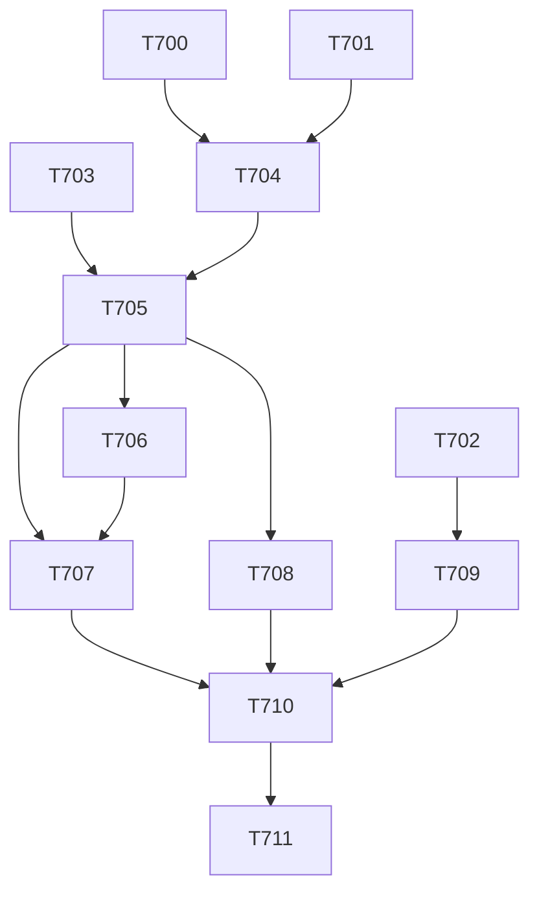

# plan-124 — Release v9.0.0: audit, prepare, gate, publish

**Created:** 2026-11-01
**Based on:** `docs/decisions/ADR-010-drop-cursor-platform-support.md` (accepted 2026-10-16: v9.0.0, MAJOR, no deprecation release; Appendix A: the draft migration text); `docs/checkpoints/checkpoint-039-post-v8-follow-ups-complete.md`; `docs/artifacts/tracked-debt-register-v3.md` (§5 theme 7, §6.1, §6.2 D-12 and D-13); `docs/artifacts/security-review-t697-t699-debt-checkpoint-refresh-v1.md`; `docs/tasks/task-T679.md` §3a (the v9.0.0 migration items); the v8.0.0 release plans `plan-120` to `plan-122` (the sequence reused here).
The user's answers of 2026-11-01 (AskUserQuestion, verbatim option labels): question 1 "Approve (Recommended)"; question 2 "Yes, in v9.0.0 (Recommended)"; question 3 "Decide after T702 (Recommended)"; question 4 "Yes, rehearse (Recommended)".
Last release: v8.0.0 (2026-10-16). `develop` at `8cc091d3` (`git describe`: `v8.0.0-78-g8cc091d3`; 40 non-merge commits since the tag): ledger empty (497 done), root drift 0, full suite 2188 OK, scorecard 34/30/0, `main` has 1 commit not in `develop` (the v8.0.0 merge commit) and a trial merge of `develop` into `main` is clean.
**Scopes:** `T700` to `T711` (created only after this plan is merged with the user's approval).

## Goal

Publish `v9.0.0`, the release that removes Cursor support (ADR-010), with one release document `docs/releases/v9.0.0.md` that carries every migration item, a full gate sequence, and the first real tag pipeline on `CI_JOB_TOKEN` (T686). The only open `SECURITY:MEDIUM` item, SEC-T662-01, is closed by this release; no `SECURITY:HIGH` or `CRITICAL` item may be open at the tag.

## Task Decomposition

**Wave 1 (parallel, no file overlap)**

1. **T700** — Release-level audit of `v8.0.0..develop` (tech-lead, read-only, one artifact `docs/artifacts/release-v9-audit-v1.md`): breaking and behaviour changes; the Migration items (ADR-010 Appendix A with SEC-T662-01 and SEC-T678-03; T672 plain install merges; T676 GitHub server removed; T680 Pi placeholders; and, per decision D-13, T688 qa-engineer 20 to 19 GitLab tools, T689 the token file in memory by default, T690 two code-launching servers added to `.vscode/mcp.json` on `--update` (SEV-T690-07), T693 the release-gate input); Known issues (the v8.0.0 K-items still true and the register v3 items an adopter must know); the version markers and stale counts; the release job's readiness on `CI_JOB_TOKEN` (SEC-T686-03, SEC-T686-06). *Acceptance:* every merged task since v8.0.0 is classified (breaking / behaviour / internal), with file and line evidence or (unverified).
2. **T701** — Token-docs batch (devops-engineer, docs; decision D-12, recommended): SEC-T689-01 (the creation snippet must not follow an existing symbolic link), SEC-T689-03 and SEC-T699-01 (the at-rest caveat in migration step 2 and in the env-var table `docs/wiki/mcp-servers.md:44`; "the setup instructions export the token" corrected in both `AGENTS.md` copies and `docs/wiki/mcp-servers.md:160`), SEC-T689-02 and SEC-T689-06 (wording). *Acceptance:* all gates and the suite pass; root drift declared if any projection changes; a Security Engineer review follows.
3. **T702** — Dependency audit of the pinned MCP set (security-engineer with devops-engineer running the commands): `audit-mcp-pins.py audit --audit-level high` **without `--accept`** (user action A-6: the Brave acceptance SEC-T676-02 expires on 2026-11-21) and the other pinned packages. *Acceptance:* a recorded result per package; if the two Brave HIGH findings remain, the user decides (question 3 below) before T705; any other `SECURITY:HIGH` blocks.
4. **T703** — Release-gate check of the migration pointer (devops-engineer; second half of SEC-T662-01): `scripts/verify-release-docs.py` (or a test it runs) fails when a `docs/releases/v*.md` path named in `scripts/install.sh` does not exist in the tree or lacks its Cursor migration item. *Acceptance:* the check fails on today's tree (the document does not exist yet) and passes after T705; a test pins it.

**Wave 2 (prepare, on `release/v9.0.0`)**

5. **T704** — Open `release/v9.0.0` from `develop` after wave 1 (a user-approved root refresh first if drift is not 0); bump the version markers and fix the stale lines and counts T700 lists (release-manager). *Acceptance:* `scripts/check-version-consistency.py` passes for v9.0.0.
6. **T705** — Write `docs/releases/v9.0.0.md` from `docs/releases/_template.md` and T700 (release-manager): the Migration section with the Cursor item of ADR-010 Appendix A (M-9 steps, the v5.0.0 to v6.9.0 keys `e2b`, `redis`, `figma`, `notion` and `filesystem`, `--force-prune-keys` only from the `v8.0.0` tag, the Known Issue "a Cursor install left in a project is frozen and is not pruned", and SEC-T678-03: a leftover `.cursor/` is no longer updated and its agents are not tool-restricted) and every other item of T700; the restatement that the two Brave HIGH findings block the tag if their acceptance lapses (security review T697-T699). *Acceptance:* `verify-release-docs.py --tag v9.0.0` and the T703 check pass; SEC-T662-01 closed.
7. **T706** — Rehearse the release job in the real CI image without publishing (devops-engineer; as T647 for v8.0.0, now with the `JOB-TOKEN` header path of T686): `scripts/publish-release.py --skip-api` with a fake tag in a scratch clone. *Acceptance:* the generated `CHANGELOG.md` and the release body equal the release document; no GitLab write.

**Wave 3 (gates)**

8. **T707** — QA release gate (qa-engineer): the full suite, golden suite and scorecard, `verify-release-docs.py`, `check-version-consistency.py`, `check-main-develop-drift.py`, a clean install and `--projections-only` into scratch targets, and the Migration steps replayed on a scratch **v8.0.0** install that holds a Cursor tree, a `github` server entry and Pi `${env:X}` placeholders. *Acceptance:* a gate verdict.
9. **T708** — Tech Lead review by area (tech-lead, read-only): installer and generator; knowledge text and rulings; CI and release job; documentation. *Acceptance:* a verdict per area.
10. **T709** — Release-level security re-check (security-engineer, read-only): the delta since T650 (plan-123, T689 to T699, T701, T703) and T702's result; confirms SEC-T662-01 closed and that no `HIGH` or `CRITICAL` is open. *Acceptance:* a verdict; any `CRITICAL` or `HIGH` blocks.
11. **T710** — Release manager verdict (release-manager): the `## RELEASE VERDICT` block and `## Gate Verdicts` from T707 to T709. *Acceptance:* `verify-release-docs.py` passes with the verdict in place.

**Wave 4 (publish)**

12. **T711** — Publish (orchestrator; **each step needs the user's explicit approval at that moment**): MR `release/v9.0.0` to `develop`; MR `develop` to `main` with a merge commit; tag `v9.0.0` on the verified `main` tip; watch the tag jobs (the first real tag pipeline on `CI_JOB_TOKEN`: user action A-5, SEC-T686-03 and SEC-T686-06 recorded); `docs/checkpoints/checkpoint-040-release-v9.0.0.md`. *Acceptance:* the GitLab Release body equals `docs/releases/v9.0.0.md`; all tag jobs green.

## Resource Assignments

| Task | Agent | Notes |
|---|---|---|
| T700 | tech-lead | Read-only; writes one artifact |
| T701 | devops-engineer | Docs and snippets only; Security Engineer review |
| T702 | security-engineer, devops-engineer | The engineer runs the audit commands; the reviewer grades |
| T703 | devops-engineer | Release tooling and its test |
| T704, T705, T710 | release-manager | On `release/v9.0.0`; the technical-writer has no shell, so the release manager writes and commits |
| T706 | devops-engineer | Local docker; no GitLab writes; no tag, no release |
| T707 | qa-engineer | Test files only |
| T708 | tech-lead | Read-only |
| T709 | security-engineer | Read-only; the orchestrator records it |
| T711 | orchestrator | Subagents never merge, tag or release |

## Risk Assessment

| Risk | Mitigation |
|---|---|
| The Brave acceptance lapses on 2026-11-21 before the tag | T702 first; the user decides (question 3) |
| The first real tag pipeline fails on `CI_JOB_TOKEN` (protected tag, job-token scope, runner clone method) | T706 rehearsal; the tag is never moved or deleted; a failed release job is re-run, not re-tagged |
| A migration item missed (Cursor, GitHub server, Pi placeholders, token default) | T700 classifies every merged task; T707 replays the Migration on a real v8.0.0 install |
| `git push` fails | Commits API fallback (skill `gitlab-api-push-fallback`), tree verified |
| Agent token overruns (T689, T697) | Budgets in each brief; the orchestrator splits a task that cannot fit |

## Questions for the user

1. Approve plan-124 as written?
2. D-12: fold the token-docs batch (T701) into this release? Recommended yes: users copy from those documents.
3. If T702 still finds the two Brave HIGH findings: (a) renew the acceptance in a new version for the release, (b) update or replace the Brave server first, or (c) hold the release.
4. Rehearse the release job in the CI image (T706)? Recommended yes, because the job changed (T686).

## Not in scope

The other LOW batches of register v3 (the knowledge batch, the CWSO hardening batch): after the release. CWSO, Hindsight, the `t407-tb-delta` worktree, the user's local `.claude/settings.json` and `.vscode/mcp.json`.

## Constraints

- Subagents never merge, never create or push a tag or a release, never use `WIKI_TOKEN`; the orchestrator merges only on `mergeable` with a green pipeline and a pinned sha.
- Never open `tests/golden/held-out/`; never write a held-out id; no `.env*` or credential files; never print a secret value.
- Task rows are created only after this plan is merged and the user has approved it.

## Addendum (2026-11-01): the decisions after wave 1 and T712

T702 found the Brave pin `@brave/brave-search-mcp-server@2.1.4` affected by seven advisories (five graded high by npm, two moderate), two more than the acceptance SEC-T676-02 covers; no newer release exists. The Security Engineer graded all seven: none is reachable in a harmful way in the shipped stdio mode; an environment variable or a `.env` file can switch the server to the HTTP transport (SEC-T702-07). The user's answers of 2026-11-01 (AskUserQuestion, verbatim option labels): on Brave, "Grade, then renew (Recommended)" and, after the grading, "Renew + force stdio (Recommended)" (the option stated: scope all seven advisories, expiry the first Brave release above 2.1.4 or 2027-01-30, stdio only, `--transport stdio` added to the shipped launch arguments, one more root refresh before the release branch). On the T700 decisions: D-T700-1 "Exclude docs/decisions/ (Recommended)" and D-T700-2 "Fix in T704 (Recommended)" (both carried into T704).

13. **T712** (devops-engineer): add `--transport stdio` to the shipped `brave` launch arguments, with the pin test requiring exactly that form; regenerate the mirrors and the registry and declare the root drift; write `docs/artifacts/brave-audit-acceptance-v3.md` (the seven advisories, the user's words, expiry, conditions, the gate command); update the gate command in `docs/wiki/mcp-pin-bump-checklist.md` and its test. *Acceptance:* `audit-mcp-pins.py audit --audit-level high` with exactly the seven v3 `--accept` entries passes; all gates and the suite pass; a Security Engineer review follows.
