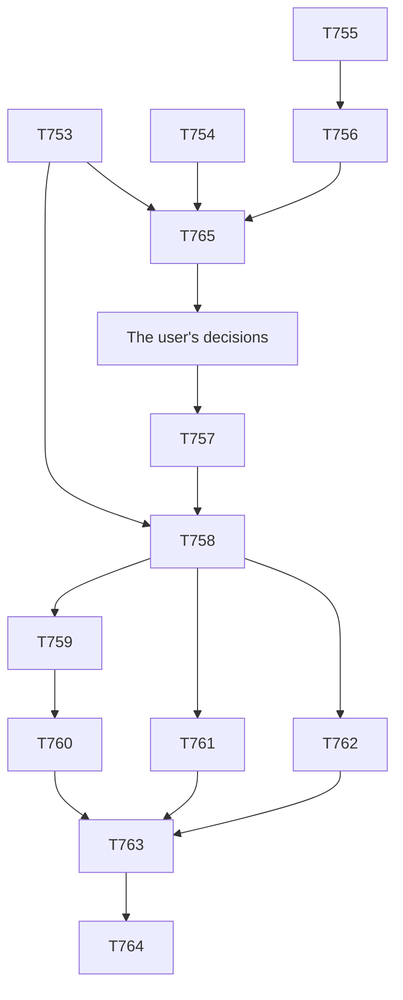

# plan-145 — Release v10.0.0: audit, prepare, gate, publish

**Created:** 2026-11-06
**Based on:** `docs/artifacts/tracked-debt-register-v11.md` (§ 6.1, § 6.2, § 6.3, § 7), `docs/plans/plan-124-*.md` (the v9.0.0 release, whose shape this follows), `CONTRIBUTING.md` § Cutting a release, skill `release-workflow`, ADR-011, ADR-012.
The user's answers of 2026-11-06, verbatim: "release go"; AskUserQuestion, option labels: version "v10.0.0, MAJOR (Recommended)"; scope "Add batch W only (Recommended)"; rehearsal "Docker, this rehearsal only (Recommended)".
Last release: v9.0.0 (2026-11-01). `develop` at `6d4abc1b`; ledger empty (549 done); root drift 0; full suite 2698 OK; scorecard 34/30/0. `main` is at `3510b0e9` and is not an ancestor of `develop` (the v9.0.0 merge commits).
The user approved this plan on 2026-11-06, AskUserQuestion, option label verbatim: "Approve (Recommended)".
**Scopes:** `T753` to `T765`.

## Goal

Publish `v10.0.0`, with one release document `docs/releases/v10.0.0.md` that carries every migration item, a full gate sequence, and the first real run of the `release` job since its script changed.

## Why MAJOR

T725: `install.sh --update` and `--projections-only` delete the authoring-only command `/prepare-release` from target projects. The audit may find more; if it finds something that changes the version, the orchestrator returns to the user.

## Task Decomposition

### Wave 1, on `develop` through merge requests, before the release branch

1. **T753** — Release-level audit of `v9.0.0..develop` (tech-lead, read-only; `docs/artifacts/release-v10-audit-v1.md`): breaking and behaviour changes; each migration item with its source; each item of register v11 § 6.2, with who handles it and in which task; what the release document must not assume, such as what target projects receive (§ 6.2 item 13). *Acceptance:* every change that reaches a target project or a release author is listed, with a citation, and each § 6.2 item has a line.
2. **T754** — Batch W (devops-engineer): fix the flaky test TD-T746-01, `test_merge_mcp_json_robustness.py:169`, so that it still catches a predictable temp name without matching a process id by chance. *Acceptance:* the new assertion fails when the name holds the process id as a separate part, on a throwaway copy; it passes 1000 times against random names with a two-digit process id; the merge request is small.
3. **T755** — Dependency audit of the pinned MCP set (devops-engineer runs it; `docs/artifacts/mcp-pin-audit-v10-v1.md`): `scripts/audit-mcp-pins.py audit --audit-level high` with and without `--accept`; `pip-audit` on the generated `requirements-uvx.txt`; the three manual advisory reads the script lists; the image digests by hand; Brave's newest version. *Acceptance:* each finding is new or is named in `brave-audit-acceptance-v3.md`. A new HIGH or an expired acceptance goes to the orchestrator at once, because it blocks the release.
4. **T756** — The state of the accepted MEDIUMs (security-engineer, read-only, with T755's result; `docs/artifacts/security-review-t756-accepted-mediums-v1.md`): for each of SEC-T660-01, SEC-T665-01, the SEC-T658-01 remainder and SEC-T702-09, and for TD-T697-07 if this release ships it: what the finding is today, its carried plan and that plan's deadline, whether that deadline has passed (ADR-012: it then counts as moved later), whether the grade still holds, and a proposed plan with an owner, a fix and a deadline still ahead. *Acceptance:* one row each, with the deadline as read from its source. The agent recommends and the user decides.

**After T756 the orchestrator asks the user about each finding:** fix it, or accept it for v10.0.0, naming the release and showing the plan and a deadline ahead (ADR-011, ADR-012; § 6.2 item 2; SEC-T735-08). No agent grants or carries one over. A finding that the user wants fixed returns here as a task, and the rest waits for it.

**T765, added 2026-11-06 after T753 and T756** (devops-engineer), before the user's decisions and T757:
- **SEC-T756-01, `SECURITY:HIGH`:** bump `python:3.12-alpine` in all 8 places to the 3.12.16 digest, as the recipe in `.gitlab-ci.yml` says, with its Alpine and package pins and `ci_images_reviewed_on`. A HIGH cannot be accepted (ADR-011), so this blocks the release. T759's approved Docker rehearsal uses the new digest.
- **SEC-T756-02's check, no Docker:** whether the compromised chains validate against the CA bundle in the new digest's layers, and how the runner pins `git`'s CA. A result of reachable returns it to the Security Engineer as HIGH.
- **TL-T753-04:** the stale note at `scripts/install.sh:1749-1750`.

### The user's decisions for v10.0.0, wave 1's outcome

Recorded 2026-11-07, AskUserQuestion, each with the question as shown, for the release's Conditions block (ADR-011, ADR-012, § 6.2 item 9). The questions named v10.0.0 and showed these plans. Each answer, verbatim: "Accept for v10.0.0 (Recommended)". **The rules do not say whether a new acceptance cures a passed deadline**, and the two questions it applies to said so.

| Finding | Grade | Plan as shown | Deadline as shown |
|---|---|---|---|
| SEC-T660-01 and SEC-T665-01 | MEDIUM | Owner the user (isolation), devops-engineer (documentation). Fix: none possible in the harness, none planned. Returns at every release until the agents are isolated | A review by 2027-01-28, at the token renewal, **not a fix date** |
| SEC-T657-01/SEC-T658-01 remainder | MEDIUM | Owner devops-engineer, review tech-lead. Fix: re-check the vendors' per-agent scoping and evaluate a server-level GitLab deny on Gemini | 2027-01-31 |
| SEC-T702-09 | MEDIUM | Owner devops-engineer. Fix: bump to the first Brave release above 2.1.4 | 2027-01-30 or that release, whichever comes first |
| SEC-T756-02 | MEDIUM | Owner devops-engineer, review security-engineer. Fix: add the check as a step at every image bump, and settle the open points | 2027-02-19, and before any earlier image bump |

T763 records "none possible" as the review's section "Re-grade after T765" words it: never a fix date, never "mitigated" without "not closed". TD-T697-07 is not shipped by v10.0.0 and stays on its own date, 2027-01-29.

**The rehearsal.** The user, verbatim: "Approve both (Recommended)": T759 uses `python:3.12-alpine@sha256:e064671ca452259bab50e8e2c7bd896e39e9a343bb06ca25234adf6fe18d0fc7`, and adds one read-only command: print the Python version, and search the built `_ssl` module for one blocked key hash. SEC-T756-01 closes only with that check. If it finds no block, SEC-T756-01 reopens as the review says.

**Wave 1's findings for the later tasks.**
- **T753:** MAJOR holds, for more than T725: T722 and T714 also break an installed target. T758 takes M-1 to M-6 from `docs/artifacts/release-v10-audit-v1.md`, with M-1's wording in place of § 6.2 item 1's. `--projections-only` must not be the step from v9 to v10 (M-2). Targets receive neither `scripts/verify-release-docs.py` nor `docs/releases/_template.md` (§ 6.2 item 13, settled by an install).
- **T755:** no new HIGH in the pinned MCP set; the seven Brave ids are as accepted. SEC-T756-07, two moderates through `server-filesystem`, is graded LOW and tracked.
- **T762** re-reads the Node advisory if it is published by then (SEC-T756-05).
- **For the next register:** SEC-T756-01 to -08; TL-T753-05, -06, -07; § 6.2 item 19's correction, that changing the review date needed a test edit, now gone (T765); the audit's remark on `build.py:12` was wrong (T765).

**Token use (the harness's count).** T753 about 171k against 130k; T754 about 65k against 50k; T755 about 124k against 80k; T756 about 246k against 100k; T765 about 173k against 110k.

### Wave 2, on `release/v10.0.0`

5. **T757** — Open `release/v10.0.0` from `develop` after wave 1, with a user-approved root refresh first if drift is not 0. Bump the version markers, and fix stale version references that `scripts/check-version-consistency.py` names (release-manager).
6. **T758** — Write `docs/releases/v10.0.0.md` from `docs/releases/_template.md` and T753 (release-manager). It carries the T725 migration item (§ 6.2 item 1); current `install.sh` citations, TD-T723-01 (item 4); the visible changes of batches G, S and T (item 7); every `<placeholder>` replaced with its value, not moved into a code span (item 27). The two batch Q ids are settled here: SEC-T735-08 by how the orchestrator asks (above), SEC-T735-09 by removing or keeping the pointer sentence before the independent check, not after it (item 10). *Acceptance:* `verify-release-docs.py --tag v10.0.0` passes on the locked parser; each § 6.2 item T753 assigns here is done.
7. **T759** — Rehearse the release job in the real CI image without publishing (devops-engineer). **The user approved Docker for this rehearsal only, on the host in `DOCKER_HOST`:** one short-lived container of the pinned `python:3.12-alpine` image, no token, a fake API endpoint, nothing else on that host touched, and the container and image removed and `docker ps -a` checked afterwards. It runs the job's `before_script` and `script` against a throwaway clone: `apk`, the release script, `CHANGELOG.md` below `[Unreleased]` (item 6) and the escaped references (item 7). *Acceptance:* a record `docs/artifacts/release-rehearsal-t759-v1.md` says what ran, what it wrote, what was not exercised, and the host's state afterwards.

### Wave 3, the gates, on the release branch

8. **T760** — QA gate (qa-engineer): the full suite, golden suite and scorecard, `verify-release-docs.py`, `check-version-consistency.py`, `check-main-develop-drift.py`, and an install and `--update` of the release on a throwaway target, which shows the T725 deletion.
9. **T761** — Tech Lead review by area (tech-lead, read-only): installer and generator; knowledge text and rulings; CI and the release job; documentation.
10. **T762** — Release-level security re-check (security-engineer, read-only): the delta since T709, T755 and T756, and the release document's claims. It confirms no HIGH or CRITICAL, no Immutable Security Constraint breach, and no weakened control.
11. **T763** — Release manager verdict (release-manager): `## Gate Verdicts` and `## RELEASE VERDICT` from T760 to T762, with `Issued at commit` and the Conditions block (§ 6.2 items 3, 9). **The independent check is `@tech-lead`** (item 11), who has not edited the release files. After it, only the closed list in `agents/release-manager.md:46` may change (item 12).

### Wave 4, publishing

12. **T764** — Publish (orchestrator, **each step needs the user's explicit approval at that moment**): the order of `CONTRIBUTING.md` § Cutting a release: `release/v10.0.0` to `develop`, then to `main`, no squash, then the tag on the release branch's tip. Watch the tag pipeline with `CONTRIBUTING.md`'s first-tag rehearsal (§ 6.2 items 6, 8, 14, 28). Afterwards: the release's body against the document, `check-main-develop-drift.py`, the release checkpoint (`/prepare-release` step 6; `/validate-tasks` first). If the job fails, the tag is never moved or re-created without the user: fix forward, or use the manual fallback.

## Risk Assessment

- **The `release` job has never run this code.** Both gate probes skipped it. T759 reduces this and does not remove it. It fails closed: no Release is created, and the manual fallback in `CONTRIBUTING.md` stands.
- **The credential path of the tag jobs is unproved** (the project is public), and the clone setting on `release` is new. Same outcome.
- **A new HIGH from T755** blocks the release, and an acceptance cannot cover it (ADR-011).
- **The Brave acceptance ends on 2027-01-30** or at the first Brave release above 2.1.4. If that happens before the tag, the audit needs a new acceptance or a bump first.
- **The CI image review date** goes stale on 2027-02-19, after this release if it stays on schedule.
- **Token use.** Every gate agent of the last two weeks has used 160k to 230k by the harness's count, against budgets of 60k to 120k. Twelve tasks at that rate are about two million tokens. The orchestrator keeps each brief narrow, and reports the count at the checkpoint.

## Not in scope

Batch V and the other tracked batches, unless a gate finds one blocks. SEC-T741-17's runner. The route of SEC-T735-06 and -07.

## Constraints

- Subagents never merge, push, tag or release. The top-level session merges after its own verification; the tag and the Release take the user's approval each.
- `tests/golden/**` and `scripts/scorecard.py` stay protected. Never open `tests/golden/held-out/`. A root refresh needs the user's approval. No `docker` command outside T759.
- Every mutation run: a full throwaway copy, a checked baseline, a timeout and a memory cap.

## Outcome (2026-11-07)

v10.0.0 is published. The user approved each publishing step at its moment: "develop go" (MR !654, `c8f538d6`), "main go" (MR !655, `623eea7c`, no squash, `verify-main-sync-merge.py` PASS, `main` pipeline 3039866416 green), "tag go" (annotated tag `v10.0.0` on the release tip `d593aeb3`). Tag pipeline 3039977704 passed all three jobs, and the `release` job created the GitLab Release with a description equal to `docs/releases/v10.0.0.md` at the tag. Afterwards: `main=v10.0.0 develop=v10.0.0 releases_behind=0`; `/validate-tasks` PASS. The release verdict stays CONDITIONAL_PASS (T763); five MEDIUMs ship accepted for this release only. The tag pipeline's observations (register v11 § 6.2 items 6, 8, 14, 28; D-T710-2 now observed) and the carried items are in `docs/checkpoints/checkpoint-041-release-v10.0.0.md`. The risks "the `release` job has never run this code" and "the clone setting is new" did not materialize; "the credential path is unproved" stands, because the project is public.
