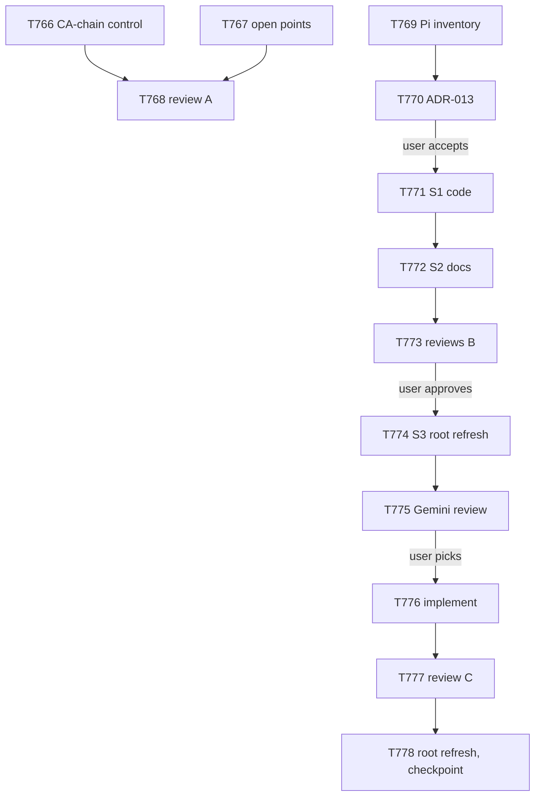

# plan-146 — SEC-T756-02 fix, Pi removal, then the SEC-T657-01/SEC-T658-01 remainder

**Created:** 2026-11-07
**Based on:** `docs/checkpoints/checkpoint-041-release-v10.0.0.md`; `docs/artifacts/security-review-t756-accepted-mediums-v1.md` (§ Part 1, § 2 "SEC-T756-02: final grade"); `docs/artifacts/ca-check-t765-v1.md` (§ Could not establish); `docs/decisions/ADR-010-drop-cursor-platform-support.md` and plan-123 tasks T661, T662, T678, T679 (the Cursor removal, whose shape Part B follows); `docs/wiki/mcp-pin-bump-checklist.md`.
The user's request of 2026-11-07, verbatim: "Plan for: Fix of SEC-T756-02, Remove PI support completely, then review and work on SEC-T657-01/SEC-T658-01".
State: v10.0.0 published; `develop` at `f032d7f6`; ledger 0 active, 562 completed; root drift 0; full suite 2700 OK (25 skipped) in a clean worktree.
**Scopes:** `T766` to `T778`.

## Goal

Three outcomes, in this order:

- **A. SEC-T756-02 closed or re-graded LOW.** The CI's `git` relies on the image's CA bundle alone. A control that runs in CI must prove that none of the 16 compromised chains validates against each pinned image's own bundle, and the open points of T765 must be settled.
- **B. Pi support removed completely**, under a new ADR-013, in the same steps as the Cursor removal: inventory and ADR, the user's decisions, code removal, docs removal, then the root refresh with the user's approval. No adopter's `.pi/` files are ever deleted by the installer.
- **C. The SEC-T657-01/SEC-T658-01 remainder reviewed and reduced.** After B, the remainder is Gemini CLI only: any agent can call every tool of every configured MCP server except the six denied Playwright tools, GitLab writes included. The review re-reads the current Gemini CLI documentation and proposes options, the user picks one, and it is implemented.

"Done" means: A and C each re-graded by a Security Engineer, B accepted by the gates with no Pi reference outside the historical records, and the ledger empty. The release that ships B is a MAJOR (v11.0.0) and gets its own plan.

## Scope

- **In scope:** the CA-chain control and the checklist step (A); ADR-013, the removal of `implementation/platforms/pi.json`, both `.pi/` trees (91 files each), the Pi-only generator paths (the `pi` MCP format, `optional` env rendering for pi, `skipFormats: [pi]`), the installer, the renderer, the registry, the tests and the live docs (B); the Gemini review, the chosen fix and the re-grade (C).
- **Out of scope:** the v11.0.0 release; tracked-debt register v12 (it can run between parts, at the user's word); SEC-T660-01 and SEC-T665-01 (no fix in the harness); SEC-T702-09 (waits on Brave); Opencode's built-in agents (K-23, a separate user decision); TD-T697-07 (CWSO repository); the CWSO repository's 411 local modifications.
- **Assumptions:**
  - The six open golden cases that mention Pi read only their own `fixture/` directory, as ADR-010 V11 found for Cursor. If T768 finds otherwise, the edit needs a named grant from the user, and a baseline.
  - The runner's feature flag `FF_GIT_URLS_WITHOUT_TOKENS` cannot be read from this side without risk, so it becomes a user action.

## Task decomposition

### Part A — SEC-T756-02 (first: its deadline is any image bump, and the Node advisory is due 2026-11-11)

1. **T766, CA-chain control** (devops-engineer):
   - Vendor the 16 public chains of the eMudhra disclosure, with a control chain that must validate, as test fixtures.
   - Add a check that verifies them against a given CA bundle, needing no network or Docker.
   - Run it in a merge-request CI job inside each pinned image (`python:3.12-alpine` and the Node image) against that image's own bundle. A digest bump then fails the pipeline if any compromised chain validates.
   - Add it as a step in `docs/wiki/mcp-pin-bump-checklist.md` § 3.
   - **Acceptance:** 0 of 16 validate and the control passes on both current digests. A mutation run shows the job fails when a compromised root is added to the bundle copy. The job is limited to merge-request and branch rules, and the three tag jobs are unchanged.
2. **T767, open points** (devops-engineer, which has the shell to extract image layers, as in T765; T768's Security Engineer grades the result):
   - Search crt.sh for other cross-signs of the compromised keys.
   - Check the targets behind `/etc/ssl/certs` in both images.
   - Find out why `emSign ECC Root CA - G3` is missing from Alpine's bundle.
   - Record what the v10.0.0 tag pipeline settled: gitlab-runner 19.5.3, the Docker executor.
   - `FF_GIT_URLS_WITHOUT_TOKENS` becomes user action A-21, because only the runner's owner can read it.
   - **Output:** `docs/artifacts/ca-check-t767-v1.md` with the re-grade of SEC-T756-02.
3. **The user's choice after T767** (one question): add a CA pin for the job's own `git`, or not. The pin fails closed, so a change of certificate authority on gitlab.com stops the tag jobs. The tag pipeline has now proved the pinned commands, which removes the reviewer's earlier objection. My recommendation: no pin, because the CI control in T766 covers the risk without the outage mode.
4. **T768, security review of Part A** (security-engineer). It must pass before the merge.

### Part B — remove Pi (ADR-013; MAJOR)

5. **T769, inventory** (tech-lead, which has Bash): `docs/artifacts/pi-removal-inventory-v1.md`, in the classes of ADR-010 D1. It must cover:
   - every tracked file that names Pi, outside the historical records;
   - the generator's Pi-only branches: the `'vscode' || 'pi'` emit branch, `optional` rendering, `skipFormats`;
   - the installer: managed paths, `validate_before_update`, `install_pi`, the dispatch and `all`;
   - `render_installed_agents.py`, `merge-mcp-json.py`, `scripts/deploy`, the registry, the schema and the pack fixture;
   - count words ("six platforms");
   - test floors like ADR-010 V15;
   - the six open golden files, read only for whether they read anything outside their fixture.
   - Never open `tests/golden/held-out/`.
6. **T770, ADR-013** (solution-architect, from T769's inventory), which proposes the user's decisions:
   - the version (MAJOR, v11.0.0);
   - adopter behaviour for `--platform pi` and an existing `.pi/` (ADR-010's B: an error and a read-only notice, never delete);
   - deleting both trees;
   - the pack schema enum;
   - golden handling;
   - the migration item for the release document.
   - **The user accepts or changes ADR-013 before any removal.**
7. **T771, step S1, code removal** (devops-engineer): the manifest, both trees (`git rm -r`, because `sync --check` and the parity gate cannot see an orphan tree), generator, installer, renderer, registry, schema, tests, and a guard test that fails if a `.pi/` tree or a `pi` manifest reappears.
8. **T772, step S2, docs removal** (technical-writer for the text; devops-engineer regenerates the mirrors and the registry): README, both `AGENTS.md`, PREREQUISITES, SECURITY, CONTRIBUTING, the wiki, the knowledge sources and their count words, the `.gitlab` templates, the release template. The root drift is declared, and the root is not refreshed.
9. **T773, reviews of S1 and S2** (security-engineer and tech-lead, read-only).
10. **T774, step S3, root refresh** (orchestrator): **only with the user's approval at that moment.**

### Part C — SEC-T657-01/SEC-T658-01 remainder (after B, as the user ordered)

11. **T775, review** (security-engineer; the orchestrator fetches the vendor documentation through Context7 and the web): re-read the current Gemini CLI documentation and source for per-agent or per-subagent scoping of MCP tools, and re-grade the remainder now that Pi and Cursor are gone. It lists options with their cost and their effect on your own Gemini session:
    - (1) per-agent scoping, if it exists now;
    - (2) a server-level `includeTools` allowlist for `gitlab`: the union of the seven roles' named tools, for all of Gemini;
    - (3) a server-level `excludeTools` for the GitLab tools no agent holds (merge, push, delete, branch, tag and release creation), through the existing `denyTools` mechanism of `servers.yaml`;
    - (4) the same treatment for the other `denyUnlessGranted` servers.
    - **Output:** `docs/artifacts/security-review-t775-gemini-scoping-v1.md`.
12. **The user picks the option(s).**
13. **T776, implementation** (devops-engineer): the chosen option in the generator and `servers.yaml`, tests that pin the emitted lists, the live-check steps in the checklist § 6, the docs (AGENTS.md MCP section), regeneration, and the root drift declared.
14. **T777, security review and re-grade** (security-engineer). Then **T778** (orchestrator): the root refresh for C, with the user's approval, the checkpoint, and this plan's Outcome.

## Task graph



T766, T767 and T769 can start together: their files don't overlap. T769 only reads. Part C starts after T774, as ordered.

## Agent assignments

| Task | Agent | Scope |
|------|-------|-------|
| T766 | devops-engineer | M |
| T767 | devops-engineer | S |
| T768 | security-engineer | S |
| T769 | tech-lead | M |
| T770 | solution-architect | M |
| T771 | devops-engineer | L |
| T772 | technical-writer + devops-engineer | M |
| T773 | security-engineer + tech-lead | M |
| T774 | orchestrator | S |
| T775 | security-engineer (orchestrator fetches) | M |
| T776 | devops-engineer | M |
| T777 | security-engineer | S |
| T778 | orchestrator | S |

## Artifact flow

```
T766 → CI job + fixtures + checklist step          (consumed by: T768)
T767 → ca-check-t767-v1.md                         (consumed by: T768, the user's pin choice)
T768 → security-review-t768-ca-control-v1.md       (closes or re-grades SEC-T756-02)
T769 → pi-removal-inventory-v1.md                  (consumed by: T770, T771, T772)
T770 → ADR-013-drop-pi-platform-support.md         (consumed by: T771 to T774, the v11.0.0 release document)
T773 → security-review-t773-pi-removal-v1.md, tech-lead-t773-pi-removal-v1.md
T775 → security-review-t775-gemini-scoping-v1.md   (consumed by: the user, T776)
T777 → security-review-t777-gemini-fix-v1.md       (re-grades SEC-T657-01/SEC-T658-01)
T778 → checkpoint-042, plan-146 Outcome
```

## Risks & mitigations

| Risk | Likelihood | Impact | Mitigation |
|------|-----------|--------|-----------|
| The control's chain of trust differs between `openssl verify` and the TLS clients the jobs use (Python `ssl`, libcurl) | M | M | T766 states what it proves; T767 checks which store libcurl reads |
| The compromised chains in the repo look like a secret to the scanners | L | L | They are public certificates, not keys; record that in the MR |
| Pi shares code with other platforms (the emit branch with `vscode`, `optional` env rendering) | H | H | The inventory lists every shared branch; S1 must leave every other platform's generated bytes unchanged (a byte-equality check in T771's acceptance) |
| An adopter's `.pi/` is deleted | L | H | ADR-013 decides the adopter behaviour first; the installer never deletes |
| A golden case reads outside its fixture | L | M | T769 checks; any edit needs your named grant and a new baseline |
| Gemini's vendor documentation is unclear or changed | M | M | T775 marks every unread claim as unverified; the live-check steps in § 6 of the checklist go to you |
| A server-level Gemini allowlist also restricts your own Gemini session | H | L | It's in the options for you to weigh; same model as the Playwright denials |
| Token use runs well above the briefs' budgets, as in the last plans | H | L | Narrow briefs; report at the checkpoint |

## Constraints

- **Merging and publishing:** subagents never merge, push, tag or release. The top-level session merges after its own verification, with the MR pipeline green and the merge pinned to the verified sha.
- **Root refreshes:** each one needs your approval at that moment. The `docker` command is used nowhere.
- **Protected tests:** `tests/golden/**` and `scripts/scorecard.py` stay protected. Never open `tests/golden/held-out/`.
- **Gate checks:** the full suite runs in a clean worktree, never in the main checkout, because the main checkout holds git-ignored local files.
- **Severity rules:** a MEDIUM or higher goes to you, and LOW findings are tracked as debt.
- **Mutation runs:** each one runs on a full throwaway copy, with a checked baseline, a timeout and a memory cap.

## Token budget

| Phase | Budget | Spent | Remaining |
|-------|--------|-------|-----------|
| Part A (T766 to T768) | 120k | — | — |
| Part B (T769 to T774) | 300k | — | — |
| Part C (T775 to T778) | 150k | — | — |

## Approval

- [ ] User approved on YYYY-MM-DD

Owner change before dispatch (orchestrator, 2026-11-07): T767 moved from security-engineer to devops-engineer, because the Security Engineer has no shell and T767 must extract image layers.

## Addendum (2026-11-07): Part C becomes the Gemini removal

T775's review (`docs/artifacts/security-review-t775-gemini-scoping-v1.md`) found that Gemini CLI v0.67.0 enforces per-agent MCP tool lists, while this harness drops them (`gemini.json` `"tools": "drop"`) and its 28 Gemini agent files probably fail Gemini's loader; the remainder of SEC-T657-01/SEC-T658-01 stays MEDIUM. Asked how to fix it, the user answered (AskUserQuestion, option labels verbatim) "Agent lists + GitLab allowlist (Recommended)", "Yes, I use glab/web/other (Recommended)" and, for the servers no agent uses, "Drop Gemini support". Asked to resolve the conflict, the user chose "Drop Gemini instead of fixing (Recommended)".

Part C therefore removes Gemini support completely, in the steps of Part B (ADR-013) and ADR-010; it closes the remainder by removal. It ships in the same MAJOR release as the Pi removal (v11.0.0, a separate plan). Tasks, replacing items 11 to 14 of Part C:

- **T776, inventory** (tech-lead): `docs/artifacts/gemini-removal-inventory-v1.md`, in the shape of `pi-removal-inventory-v1.md`.
- **T777, ADR-014** (solution-architect): `docs/decisions/ADR-014-drop-gemini-platform-support.md`; the user accepts or changes it before any removal.
- **T778, step S1, code** (devops-engineer), with a byte-equality proof for every remaining platform.
- **T779, step S2, docs** (technical-writer; devops-engineer regenerates).
- **T780, reviews of S1 and S2** (security-engineer and tech-lead).
- **T781, step S3, root refresh** (orchestrator), only with the user's approval at that moment; run `--print-drift` after the refresh (the rsync size-and-time skip found in T774).
- **T782, checkpoint-042 and this plan's Outcome** (orchestrator).

Budget for the re-scoped Part C: 300k.

## Outcome (2026-11-11)

All three parts are merged into `develop` (`d9b20951`, root drift 0, ledger 0 active):

- **A (MR !658):** SEC-T756-02 is LOW. A CI control proves in each pinned image that no disclosed chain validates against that image's own CA store. The user chose "No pin (Recommended)".
- **B (MRs !659, !660):** Pi is removed under ADR-013, including the root refresh, which the user approved.
- **C (MRs !661 to !663):** Gemini CLI is removed under ADR-014 instead of being fixed, on the user's decision "Drop Gemini instead of fixing (Recommended)", including the root refresh, which the user approved. T780 closes SEC-T657-01/SEC-T658-01 by removal at v11.0.0.

Four platforms remain. The carried items (register v12, the v11.0.0 release plan with both migration items, the v10.0.0-only acceptances, A-21, the user's own settings entries) are in `docs/checkpoints/checkpoint-042-plan-146-ca-pi-gemini.md`.
