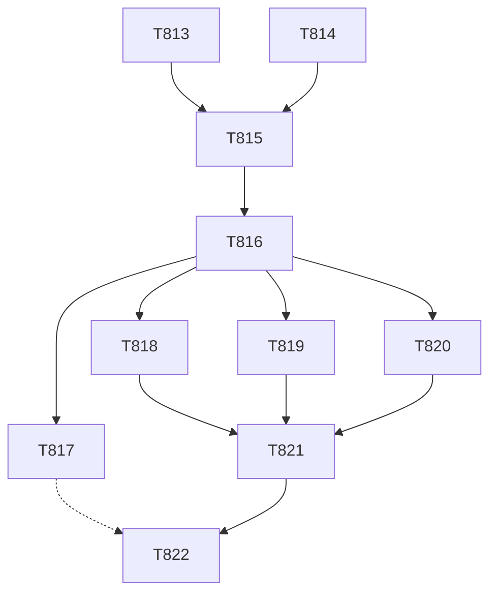

# plan-161 — Release v11.0.0: audit, prepare, gate, publish

**Created:** 2026-11-13
**Based on:** `docs/artifacts/tracked-debt-register-v16.md` (§ 6.1, § 6.2 items 1 to 42 with v11 to v15 for the carried text, § 6.3, § 7); `docs/plans/plan-145-release-v10.md` (the v10.0.0 release, whose shape this follows); `docs/plans/plan-159-release-gate-runner-tag.md` (§ Outcome); `docs/plans/plan-160-v11-confirmation-sec-t660-t665.md` (§ Outcome); `docs/artifacts/brave-audit-acceptance-v4.md`; `CONTRIBUTING.md` § Cutting a release; skill `release-workflow`; ADR-011, ADR-012, ADR-013, ADR-014, ADR-015, ADR-016.
**Scopes:** `T813` to `T825`.

## User decision (2026-11-13, verbatim)

After plan-160 merged, the orchestrator asked for the word to write the v11.0.0 release plan. The user answered:

> "release plan go

This is the word to write this plan and ask for its approval. It is not the approval itself, and nothing below runs before the user approves. Each publishing step needs the user's explicit approval at that moment.

**Approval:** pending (asked in the session; recorded here verbatim when given).

## State at writing

- Last release: v10.0.0 (2026-11-07). `develop` at `9acf84dc`, 55 commits after the tag. Ledger 0 active, 609 completed. Root drift `[]`. Full suite 2744 OK (skipped=25). `main` is at `623eea7c` and is not an ancestor of `develop` (the v10.0.0 merge commits).
- **Settled for v11.0.0 by the user**:
  - SEC-T660-01 and SEC-T665-01: accepted for v11.0.0 only, after the Security Engineer's dated confirmation T812 (plan-160 § Outcome).
  - SEC-T702-09: accepted for v11.0.0 only (`brave-audit-acceptance-v4.md`, plan-158).
- **Dates that bound the tag:**
  - 2027-01-28: the review date for SEC-T660-01 and SEC-T665-01, and the GitLab token's renewal.
  - 2027-01-29: TD-T697-07 ends. It is MEDIUM and not shipped in the release.
  - 2027-01-30: the Brave acceptance ends, or earlier at the first Brave release above 2.1.4.
  - 2027-03-12: the CI image review date goes stale.
  - **v11.0.0 must be tagged before 2027-01-28**, or the user decides again.
- **The release-gate runner** (plan-159) has never run a job. The first tag pipeline proves its routing.

## Goal

Publish `v11.0.0`, with one release document `docs/releases/v11.0.0.md` that carries every migration item and the Conditions lines of the three accepted MEDIUMs in the form ADR-011, ADR-015 and ADR-016 require, after a full gate sequence, with the three tag jobs running on the dedicated runner.

## Why MAJOR

- ADR-013 removed the Pi platform and ADR-014 removed the Gemini CLI platform. Both decided "v11.0.0, no deprecation". `install.sh` refuses `--platform pi` and `--platform gemini` with an error and a notice, and never deletes a target's `.pi/` or `.gemini/` tree.
- SEC-T791-01 changed behaviour: Cline and Opencode sessions next to `.claude/` now resolve as their own platform.
- The audit may find more. If it finds something that changes the version, the orchestrator returns to the user.

## Task Decomposition

### Wave 1, on `develop` through merge requests, before the release branch

1. **T813** (tech-lead, read-only): release-level audit of `v10.0.0..develop`, written to `docs/artifacts/release-v11-audit-v1.md`. It covers:
   - breaking and behaviour changes;
   - each migration item, with its source: the Pi and Gemini removals with what target projects keep, SEC-T791-01, and A-22 for the user's own settings files;
   - each item of register v16 § 6.2 (1 to 42, with v11 to v15 for the carried text), with who handles it and in which task;
   - batch Q (9 ids), with each id's route;
   - what the release document must not assume.

   *Acceptance:* every change that reaches a target project or a release author is listed with a citation, and each § 6.2 item has a line.
2. **T814** (devops-engineer runs it): dependency and image audit, written to `docs/artifacts/mcp-pin-audit-v11-v1.md`. It runs:
   - `scripts/audit-mcp-pins.py audit --audit-level high`, without and with v4's seven `--accept` entries;
   - `pip-audit` on the generated `requirements-uvx.txt`;
   - the manual advisory reads the script lists, and the image digests by hand;
   - npm's newest Brave release (§ 6.2 item 42);
   - whether Alpine now ships `nodejs` 24.22.3 for `unit-tests` (SEC-T786-01, item 37), and the CA-chain jobs on the current images.

   *Acceptance:* each finding is either new or named in v4. A new HIGH, or an expired or voided acceptance, goes to the orchestrator at once, because it blocks the release.

**After wave 1:** a finding that blocks the release returns here as a task. Any new MEDIUM goes to the user, asked the way SEC-T735-08 says.

### Wave 2, on `release/v11.0.0`

3. **T815** (release-manager): open `release/v11.0.0` from `develop` after wave 1. A root refresh comes first, with the user's approval, if drift is not `[]`. Bump the version markers, and fix the stale version references that `scripts/check-version-consistency.py` names.
4. **T816** (release-manager): write `docs/releases/v11.0.0.md` from `docs/releases/_template.md` and T813. It carries:
   - the migration items;
   - the Conditions line of SEC-T660-01 and SEC-T665-01 with every duty of § 6.2 item 40: the outside closer; the plain statement with T812 named and dated (2026-11-13); that the confirmation came before the question (2026-11-13); the review date 2027-01-28; for SEC-T660-01 the passed deadline "the sprint after v8.0.0" (at the latest 2026-11-01) and the release that acceptance was given for; the user's words verbatim and dated;
   - the Conditions line of SEC-T702-09 in the release document's own form (item 2);
   - the batch Q ids T813 routes here;
   - every `<placeholder>` replaced with its value.

   *Acceptance:* `verify-release-docs.py --tag v11.0.0` passes on the locked parser, and each § 6.2 item that T813 assigns here is done.
5. **T817, optional, the user's choice at approval** (orchestrator, with the user's approval at that moment): a probe tag `v11.0.0-gate.1` on the release branch. It shows `release-docs-gate` and `main-develop-drift-gate` running on runner #59129270 through `gitlab-runner-16028`, with `allowed_images` matching. The gates fail on the probe's missing release document, so `release` does not run and nothing is published. Afterwards the user deletes the probe tag in the web UI.

### Wave 3, the gates, on the release branch

6. **T818** (qa-engineer): QA gate. It runs:
   - the full suite, the golden suite and the scorecard;
   - `verify-release-docs.py`, `check-version-consistency.py` and `check-main-develop-drift.py`;
   - an install and an `--update` of the release on a throwaway target. Together these show the Pi and Gemini refusals and that no `.pi/` or `.gemini/` tree is deleted.
7. **T819** (tech-lead, read-only): review by area: the installer and generator; the knowledge text and rulings; CI and the release job; the documentation.
8. **T820** (security-engineer, read-only): release-level security re-check of the delta since T812, T814 and v10.0.0's T762, and of the release document's claims, the Conditions lines included. It confirms there is no HIGH or CRITICAL, no breach of an Immutable Security Constraint, and no weakened control.
9. **T821** (release-manager): release verdict, written as `## Gate Verdicts` and `## RELEASE VERDICT` from T818 to T820, with `Issued at commit` and the Conditions block. **The independent check is `@tech-lead`**, who has not edited the release files. After it, only the closed list in `agents/release-manager.md:46` may change.

### Wave 4, publishing

10. **T822** (orchestrator; **each step needs the user's explicit approval at that moment**). The steps follow `CONTRIBUTING.md` § Cutting a release:
    1. Merge `release/v11.0.0` to `develop`, then to `main`, with no squash.
    2. Tag the release branch's tip.
    3. Watch the tag pipeline. The three tag jobs must show `gitlab-runner-16028`; if they don't, SEC-T741-17 reopens.
    4. Afterwards: compare the Release's body with the document, run `check-main-develop-drift.py`, and write checkpoint-043 (`/validate-tasks` first).

    If the job fails, the tag is never moved or re-created without the user: fix forward, or use the manual fallback.

## User actions before the tag

- **A-21:** whether any `SSL_CERT_FILE`, `SSL_CERT_DIR`, `CURL_CA_BUNDLE` or `GIT_SSL_*` CI variable is set at project, group or instance level. The new runner's `config.toml`, as the user reported it, sets no feature flags, no `tls-ca-file` and no `helper_image`.
- **A-22:** remove the Gemini entries from the user's own `.vscode/settings.json` and `.claude/settings.json`. This is not a gate input; the orchestrator never opens those files.
- **Optional (T812 point 2):** read-deny rules for the token file and the `glab` and git credentials in the user's own `.claude/settings.json`.

## Addendum 1 (2026-11-13; the orchestrator's record): wave 1 results and two fixes before the release branch

- **T813** (`docs/artifacts/release-v11-audit-v1.md`, `225dce1b`):
  - 13 changes, 8 migration items, all 42 checklist items routed except item 38, and batch Q routed.
  - Nothing blocks the release or changes the version (MAJOR).
  - Item 38 (SEC-T784-01) has no owner: `implementation/PREREQUISITES.md:4` and `:227` still ask for Node 18.
- **T814** (`docs/artifacts/mcp-pin-audit-v11-v1.md`, `40ac1bcd`):
  - No new HIGH. The Brave acceptance holds: npm's newest release is still 2.1.4. Both image digests resolve.
  - Alpine v3.24 now has `nodejs` 24.22.3-r0 (SEC-T786-01's trigger; still to be seen in a `unit-tests` log).
  - **New:** `opentelemetry-api 1.45.1` in both `implementation/runtime/*/requirements-mcp-server.lock.txt` has CVE-2026-126360 / GHSA-mf5v-w3w3-f6cg (a ReDoS in `traceparent` parsing, GitHub severity medium, fixed in 1.45.2). The orchestrator mints **SEC-T814-01** for it. The grade is pending; T814 proposes LOW.
- **Added tasks, on `develop`, before T815:**
  - **T823** (technical-writer): SEC-T784-01, checklist item 38. `implementation/PREREQUISITES.md:4` and `:227` name the fixed Node versions (≥ 22.23.5, ≥ 24.22.3 or ≥ 26.13.1) in place of "18+" (T784 § 6; T786 § Conditions).
  - **T824** (devops-engineer): fix SEC-T814-01 by bumping `opentelemetry-api` to 1.45.2 in both lock files, regenerated with hashes by the recorded `uv pip compile` command. Only that package changes, and the two files stay byte-identical.
  - **T825** (security-engineer, read-only): grade SEC-T814-01 and review T823 and T824.
  - The fix is chosen over an acceptance because it is small and available. If T825 grades the finding MEDIUM, the fix still settles it before the release, and the user is not asked.

## Addendum 2 (2026-11-13; the orchestrator's record): wave 1 closed

- **T823** (`ca1cdfa8`): `implementation/PREREQUISITES.md:4` and `:227` name the fixed Node versions in place of Node 18.
- **T824** (`6f45ef45`): `opentelemetry-api` 1.45.2 in both runtime locks (byte-identical, hashes checked against PyPI), and checklist line 24 updated.
- **T825** (`docs/artifacts/security-review-t825-v11-prep-v1.md`): **CONDITIONAL_PASS**.
  - SEC-T814-01 is graded `SECURITY:LOW` and **fixed** by T824 (minted and fixed in this release).
  - SEC-T784-01: the PREREQUISITES part is done; it closes when T816's document names the fixed versions.
  - **New, both LOW:**
    - **SEC-T825-02** (the Node floor read literally as one floor): fixed by the orchestrator. Its one-line wording follows T825's example for `:4` and `:227`. The orchestrator also removed a duplicate end-of-life sentence on `:4`. Not re-reviewed: the orchestrator's ruling. T820 reviews the release-level delta.
    - **SEC-T825-01** (no `opentelemetry-api>=1.45.2` floor in the unhashed `requirements-mcp-server.txt` inputs, so an existing environment keeps 1.45.1): part (a), the floor and regeneration, is **tracked as LOW debt** under the user's LOW policy ("Track LOW items as debt, stop chasing (Recommended)"). Part (b), the upgrade line for existing MCP server environments, goes into T816's document.
- **For T816, from T825 § 6:**
  - name the Node minimums per release line (SEC-T784-01, SEC-T825-02);
  - add the upgrade line `pip install --require-hashes -r implementation/runtime/<dir>/requirements-mcp-server.lock.txt` (SEC-T825-01 b);
  - record SEC-T814-01 as fixed in this release.
- **Budgets:**

  | Task | Used (about) | Budget |
  |---|---|---|
  | T813 | 149k | 100k |
  | T814 | 100k | 80k |
  | T823 | 72k | 30k |
  | T824 | 68k | 50k |
  | T825 | 119k | 50k |

## Risk Assessment

- **The release-gate runner has never run a job.** If routing or `allowed_images` fails, the tag jobs stay pending or fail closed, and nothing is published. T817 finds this before the real tag.
- **A new HIGH from T814** blocks the release, and no acceptance can cover it (ADR-011).
- **The dates above.** A slip past 2027-01-28, or a new Brave release, needs the user's new decision before the tag.
- **Token use.** Recent agents ran at about 1.5 to 2 times their budgets. There are ten tasks. Briefs stay narrow, and the checkpoint reports the counts.

## Not in scope

The other tracked LOW batches, unless a gate finds that one blocks. The route of SEC-T735-06 and -07. SEC-T806-01 and -02 text changes (those need an ADR). No Docker rehearsal: v10.0.0's `release` job ran green on this script, and T817 covers the new runner.

## Constraints

- Subagents never merge, push, tag or release. The top-level session merges after its own verification. The tag and the Release each take the user's approval.
- `tests/golden/**` and `scripts/scorecard.py` stay protected. Never open `tests/golden/held-out/`. A root refresh needs the user's approval. No `docker` command in any brief.
- Every mutation run uses a full throwaway copy, a checked baseline, a timeout and a memory cap.
