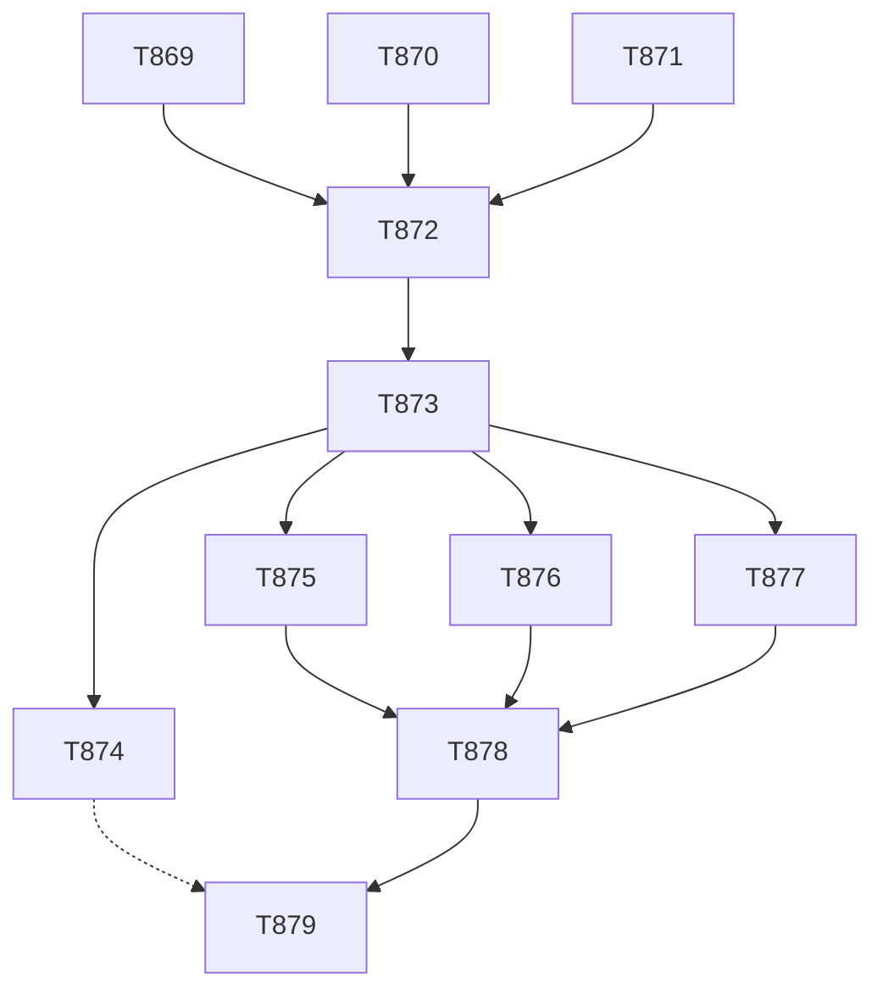

# plan-182 — Next release after v11.0.0: audit, prepare, gate, publish

**Created:** 2026-11-19
**Based on:**
- `docs/artifacts/tracked-debt-register-v25.md` (§ 6.1, § 6.2 including item 49, § 6.3, § 7);
- `docs/plans/plan-161-release-v11.md` (the v11.0.0 release, whose shape this follows);
- `docs/plans/plan-160-v11-confirmation-sec-t660-t665.md` (the dated confirmation before the acceptance question);
- `docs/checkpoints/checkpoint-043-release-v11.0.0.md`;
- `CONTRIBUTING.md` § Cutting a release, and skill `release-workflow`;
- ADR-011 (with its amendments), ADR-015, ADR-016.

**Scopes:** `T869` to `T881` (T880 and T881 added in Addendum 2).

## User decision (2026-11-19, verbatim)

> release plan go

This is the word to write this plan and ask for its approval. It is not the approval itself, and nothing below runs before the user approves. Each publishing step needs the user's explicit approval at that moment.

**Approval:** pending (asked in the session; recorded here verbatim when given).

## State at writing

- **Last release:** v11.0.0, tag on `3118924a` (2026-11-13).
  - `develop` is at `9b9a31f0`, 43 commits after the tag (22 merge requests).
  - `main` is at `2bb487ef` and is not an ancestor of `develop` (the v11.0.0 merge commits).
  - The ledger has 0 active and 665 completed tasks. Root drift is `[]`. The full suite has 2832 tests, all OK (skipped=25).
- **What changed for users since v11.0.0** (to be confirmed by T869):
  - **Brave pin:** moves 2.1.4 → 2.1.5. This fixes SEC-T702-09, a MEDIUM that v11.0.0 ships, whose acceptance ended on 2026-11-17.
  - **`server-filesystem` pin:** moves 1.0.0 → 2.4.0 (SEC-T756-07).
  - **Opencode-generated agents:**
    - a `permission:` map instead of `tools:`;
    - deny-only `bash`, `edit`, `webfetch`, `websearch` and `task` for agents that do not hold them;
    - a `task` allowlist for the two orchestrators;
    - token-directory `read` and `external_directory` denies for the 13 agents without `execute`;
    - a supported Opencode range: 1.0.224 to 1.x, tested on 1.19.2.
  - **The CA-chain control hardened:** two rollover keys added, a fixture cross-check, `sha256sum -c`.
  - **`sync-wiki.py`** refuses redirects.
  - **The context-retriever** redaction and decode fixes.
  - **`install.sh`** uses `rsync --checksum`.
  - **The pin-age rule** and its `age` check.
- **Accepted MEDIUMs that must be fixed or accepted again** (ADR-011: an acceptance covers one release only): SEC-T660-01 and SEC-T665-01, the GitLab token. Their scope on Opencode is narrower since plan-168, plan-175 and plan-178 (register v25 § 6.2 item 49).
- **Dates that bound the tag:**
  - **2027-01-28:** the review date for SEC-T660-01 and SEC-T665-01, and the GitLab token's renewal. **The release must be tagged before then**, or the user decides again.
  - **2027-01-29:** TD-T697-07 ends.
  - **2027-03-20:** the CI image review fails from this date.
  - **About 2026-11-24/25:** the two recorded young-pin exceptions lapse. After those dates, the release-time `age` check passes without exceptions.

## Goal

Publish the next release with one release document, `docs/releases/<version>.md`, after the full gate sequence, with the three tag jobs running on the dedicated runner.

## Version

**The orchestrator's recommendation: `v12.0.0` (MAJOR).** Opencode-generated agents lose permissions they had in v11.0.0:
- agents without the grant can no longer use a shell, edit files, use the web or delegate;
- the orchestrators can no longer launch the built-in agents.

A target project that relied on those defaults would break.

**The alternative: `v11.1.0` (MINOR)**, if these count as security fixes rather than contract changes.

T869 confirms or revises the version. If its finding differs from the user's choice, the orchestrator returns to the user before T872.

## Task Decomposition

### Wave 1, on `develop` through merge requests, before the release branch

1. **T869** (tech-lead, read-only): the release-level audit of `v11.0.0..develop`, written to `docs/artifacts/release-next-audit-v1.md`. It covers:
   - breaking and behaviour changes, and a version finding;
   - each migration item, with its source;
   - each item of register v25 § 6.2, with who handles it and in which task;
   - batch Q, with each id's route;
   - what the release document must not assume.
2. **T870** (devops-engineer): the dependency and image audit, written to `docs/artifacts/mcp-pin-audit-next-v1.md`. It runs:
   - `audit-mcp-pins.py audit --audit-level high --signatures` with no `--accept`;
   - `audit-mcp-pins.py age`, with no exceptions if both have lapsed by then, else with the recorded ones;
   - `pip-audit` on the uvx and runtime locks;
   - the manual advisory reads;
   - the image digests read through the registry API, with no Docker;
   - the CA jobs on the current images.

   A new HIGH, or an expired or void acceptance, goes to the orchestrator at once: it blocks the release.
3. **T871** (security-engineer, read-only): the dated confirmation for SEC-T660-01 and SEC-T665-01 before the acceptance question, as T812 did for v11.0.0.
   - It restates the current scope (item 49, narrowed by plans 168, 175 and 178).
   - It names who can close each finding outside the harness (ADR-011 amendment, SEC-T762-04 Q1).
   - It states plainly that the harness has no fix.
   - It proposes the review date.

   **Then the orchestrator asks the user:** accept for `<version>`, or fix. The answer is recorded verbatim.
4. **The orchestrator:** record the user's runner check, SEC-T811-05, in checklist § 5 once the user reports the log result. This is not a gate input.

### Wave 2, on `release/<version>`

5. **T872** (release-manager): open `release/<version>` from `develop` after wave 1. If the drift is not `[]`, a root refresh comes first, with the user's approval. Bump the version markers, and fix the stale references that `scripts/check-version-consistency.py` names.
6. **T873** (release-manager): write `docs/releases/<version>.md` from `_template.md` and T869. It carries:
   - the migration items, the Opencode permission changes first;
   - the Conditions lines for SEC-T660-01 and SEC-T665-01 in the form ADR-011 requires, with T871 named and dated, and the user's words verbatim;
   - the batch Q ids routed here;
   - no leftover placeholders.

   `verify-release-docs.py --tag <version>` must pass.
7. **T874, optional, the user's choice at approval** (orchestrator, with approval at that moment): a probe tag `<version>-gate.1` on the release branch. It shows the tag jobs routed to `gitlab-runner-16028` with the hardened `config.toml` (`services_limit = 0`). Afterwards the user deletes the probe tag.

### Wave 3, the gates, on the release branch

8. **T875** (qa-engineer): the QA gate.
   - The full suite, the golden suite and the scorecard.
   - `verify-release-docs.py`, `check-version-consistency.py` and `check-main-develop-drift.py`.
   - A fresh install and an `--update` on a throwaway target, including the Opencode agents' permission maps.
9. **T876** (tech-lead, read-only): review by area.
10. **T877** (security-engineer, read-only): the release-level security re-check of the delta since v11.0.0, T870 and T871, and of the release document's claims.
11. **T878** (release-manager): the release verdict, with `## Gate Verdicts`, `## RELEASE VERDICT`, `Issued at commit` and the Conditions block. The independent check is `@tech-lead`.

### Wave 4, publishing

12. **T879** (orchestrator; **each step needs the user's explicit approval at that moment**), following `CONTRIBUTING.md` § Cutting a release:
    1. Merge `release/<version>` to `develop`, then to `main`, with no squash.
    2. Tag the release branch's tip.
    3. Watch the tag pipeline. The three tag jobs must run on `gitlab-runner-16028`.
    4. Afterwards:
       - compare the Release body with the document;
       - run `check-main-develop-drift.py`;
       - run `/validate-tasks`, then write checkpoint-044.

    If a job fails, the tag is never moved or re-created without the user: fix forward, or use the manual fallback.

## User actions before the tag

- **SEC-T811-05:** report the runner log check: `journalctl -u gitlab-runner --since "-30 min" --no-pager | grep -iE "services|unknown|unsupported|deprecat|invalid"`. `gitlab-runner lint` already reported "Configuration file is valid." on 19.5.3.
- **The SEC-T660-01 and SEC-T665-01 decision**, after T871.
- **The rulings batch Q needs from the user** (SEC-T762-04 and TL-T761-10), if T869 routes them to this release.

## Risk Assessment

- **A new HIGH from T870** blocks the release. No acceptance can cover it (ADR-011).
- **The dates.** A slip past 2027-01-28 needs the user's new decision before the tag.
- **The hardened runner config** has not run a tag job yet. If the routing fails, the tag jobs stay pending or fail closed, and nothing is published. T874 finds this before the real tag.
- **Token use.** Recent agents ran near their budgets. Briefs stay narrow, and the checkpoint reports the counts.

## Not in scope

- The other tracked LOW batches, unless a gate finds one that blocks.
- The route of SEC-T735-06 and -07.
- Any ADR change. If one is needed, it goes to the user first.

## Constraints

- Subagents never merge, push, tag or release. The top-level session merges after its own verification. Each publishing step takes the user's approval at that moment.
- `tests/golden/**` and `scripts/scorecard.py` stay protected. Never open `tests/golden/held-out/`.
- A root refresh needs the user's approval.
- No `docker` command in any brief.
- Every mutation run uses a full throwaway copy, a checked baseline, a timeout and a memory cap.

## Addendum 1 (2026-11-19; the orchestrator's record): the user's answers at approval

The user's answers, asked in the session through a question dialog, with the option labels verbatim:
- **Plan:** "Approve (Recommended)"
- **Version:** "v12.0.0, MAJOR (Recommended)"
- **Probe tag (T874):** "Yes, probe first (Recommended)"

So `<version>` above is `v12.0.0`, and the release branch is `release/v12.0.0`. If T869's version finding differs, the orchestrator returns to the user before T872.

## Addendum 2 (2026-11-19; the orchestrator's record): wave 1 results, the user's acceptance, and two fixes before the release branch

**T869** (tech-lead), `docs/artifacts/release-next-audit-v1.md`:
- **Version:** v12.0.0 (MAJOR) is confirmed. Breaking changes B-1 to B-18 and migration items MI-1 to MI-9 are listed.
- **§ 6.2 routing:** 33 items routed.
- **Batch Q routes:** no id needs a user ruling. SEC-T762-04 and TL-T761-10 were ruled by the user on 2026-11-12 and fixed in register v16 (TL-T869-02), so this plan's user action about them is void.
- **TL-T869-01 (LOW):** `server-filesystem@2.4.0` declares `engines.node >=24`, while PREREQUISITES lists Node 22 as supported.

**T870** (devops-engineer), `docs/artifacts/mcp-pin-audit-next-v1.md`:
- **No HIGH, and no acceptance in use.** `audit --audit-level high --signatures` with no `--accept` exits 0.
- **The `age` check** needs both recorded exceptions until about 2026-11-24 and 2026-11-25.
- **Images:** not stale for amd64. The CA scripts pass locally.
- **New, for grading:** `ci/requirements-ci.txt` pins `opentelemetry-api==1.45.1`, which is affected by CVE-2026-126360 / GHSA-mf5v-w3w3-f6cg (GitHub medium, CVSS 5.3, availability only; fixed in 1.45.2). The runtime locks were fixed at v11.0.0 (SEC-T814-01), but the CI locks were never audited.
- **Brave 2.2.0** was published today. It is not pinned: it is under the age rule, and 2.1.5 has no advisory.

**T871** (security-engineer), `docs/artifacts/security-confirmation-t871-sec-t660-t665-v1.md` (2026-11-19): for v12.0.0, no harness fix exists for SEC-T660-01 or SEC-T665-01. The confirmation came before the question.

**The user's decision**, asked in the session after T871, through a question dialog that cited the T871 artifact and its date, stated the Opencode scope of item 49, and showed the plan. The option label, verbatim:

> Accept for v12.0.0 (Recommended)

The plan shown:
- **Owner:** the user (isolation) and devops-engineer (documentation).
- **Fix:** none possible in the harness. Only the user can close it outside the harness, with an isolated OS user, container or VM that holds only the scoped token; for SEC-T665-01, also encrypted or disabled swap and hibernation. GitLab and the client vendors could only mitigate.
- **Deadline:** the review on 2027-01-28, at the token renewal. **v12.0.0 must be tagged before then.**

**Two fixes before the release branch** (scopes added: `T880`, `T881`):
- **T880** (devops-engineer):
  - regenerate `ci/requirements-ci.txt` with `opentelemetry-api==1.45.2`, and check the other CI locks;
  - extend checklist § 2 so every audit covers `ci/requirements-*.txt`;
  - fix the Node floor in PREREQUISITES for `server-filesystem@2.4.0` (TL-T869-01).
- **T881** (security-engineer, read-only): grade the `opentelemetry-api` finding, and review T880.

## Addendum 3 (2026-11-19; the orchestrator's record): the two fixes, and wave 1 closed

**T880** (devops-engineer):
- **`669728c1`:** `ci/requirements-ci.txt` now pins `opentelemetry-api==1.45.2`. Only that package moved. The `--exclude-newer` cut-off is now 2026-10-30, and 1.45.2 is 21 days old.
- **`8c9b4c54`:** checklist § 2 now runs `pip-audit` on both runtime locks and on every `ci/requirements-*.txt`, enforced by a test. § 5 gained a row.
- **`4c70536b`:** PREREQUISITES keeps Node 22, 24 and 26. The opt-in `filesystem` server 2.4.0 declares `engines.node >=24`. The `engines` of the other seven pins are listed. Whether `npx` refuses it on Node 22 is unverified.

**T881** (security-engineer): `docs/artifacts/security-review-t881-ci-lock-v1.md`, **PASS**.
- **SEC-T881-01** (LOW, A06): `opentelemetry-api` 1.45.1 in the CI lock. CI-only and availability-only. Fixed by T880; v11.0.0 users need no action.
- **New, LOW, tracked: SEC-T881-02** (A08). Header line 2 of the CI lock does not reproduce the lock on its own. Fix it at the next full regeneration.
- **No floor is needed** in `ci/requirements-ci.in`.

**The orchestrator's own verification:**
- The lock diff touches only the header and the `opentelemetry-api` entry.
- PyPI's sha256 values for 1.45.2 match the lock: wheel `2cbd7373…`, sdist `d7b0008e…`, uploaded 2026-10-29T17:29Z.
- `pip-audit` on the CI lock reports no known vulnerabilities.

**Wave 1 is closed:** T869 to T871, T880 and T881. Next: merge wave 1 to `develop`, then open `release/v12.0.0` (T872).

## Addendum 4 (2026-11-19; the orchestrator's record): the probe tag (T874) and the gates (T875 to T877)

**T874, the probe tag.** The user's approval at that moment, through a question dialog, verbatim: "Yes, push the probe tag (Recommended)".
- The orchestrator pushed the annotated tag `v12.0.0-gate.1` (tag object `801c82e7`) on `51f03d38`.
- **Tag pipeline 3090926673:**
  - `release-docs-gate` (job 18196553194) and `main-develop-drift-gate` (job 18196553195) both ran on runner #59129270. The log line reads "Running on runner-oc2upzvuv-… via gitlab-runner-16028", so the job log itself ties the runner to the user's host, which v11.0.0's probe left unverified.
  - Both pulled `python:3.12-alpine@sha256:e064671c…` under the hardened `config.toml` (`services_limit = 0`).
  - **Both failed, as expected:**
    - The docs gate printed "missing required file: docs/releases/v12.0.0-gate.1.md".
    - The drift gate printed "MAIN-DEVELOP DRIFT: PASS", then "RELEASE TAG TREE: FAIL". The tree differs from `origin/main` before the release merge.
  - `release` was skipped. No Release was created: the newest is still v11.0.0.
- **The orchestrator read only the failure lines of the two job logs, as at v11.0.0.**
- **User action:** delete `v12.0.0-gate.1` in the web UI (Repository → Tags) before `v12.0.0` is pushed. While the probe tag exists it would be the previous tag of `v12.0.0` (QA-T875 C3), so it must be gone.

**T875** (qa-engineer): `docs/artifacts/qa-gate-release-v12-v1.md`, **CONDITIONAL_PASS**.
- **Every executable gate is green:**
  - the suite: 2820 OK, skipped=13. The 16 CWSO live tests are left out without the CWSO variables, which explains the difference from 2833/25;
  - golden 173 OK, and the scorecard;
  - the release checks: only the 16 pending verdict lines remain;
  - a fresh install, `--update` from v11.0.0, and rollback;
  - the Pi and Gemini refusals.
- **Conditions:**
  - QA-T875-01: the `edit: allow` wording;
  - QA-T875-02: the "What a target does not receive" paragraph;
  - C3: the probe tag deleted before the real tag.

**T876** (tech-lead): `docs/artifacts/tech-lead-release-v12-v1.md`, **CONDITIONAL_PASS**.
- **The condition, TL-T876-01:** K-36 and K-32 must report the probe's result.
- **TL-T876-02** (5 parameters in `taskMap`) and **TL-T876-04** (`--min-age-days 0`; the same as SEC-T867-01) are LOW and tracked.
- **TL-T876-05** (optional): the agent counts, re-counted by the Tech Lead.
- **TL-T876-03 is dismissed by the orchestrator.** `.gitlab-ci.yml` lines 180 and 182 already run `--capath` unconditionally in the python CA job, on both stores, as T860 recorded. Only the node job needed the guarded step.

**T877** (security-engineer): `docs/artifacts/security-review-t877-release-v12-v1.md`, **CONDITIONAL_PASS**.
- No HIGH or CRITICAL finding. The two accepted MEDIUMs have complete Conditions lines.
- **New, LOW:** SEC-T877-01 (`edit: allow`; the same as QA-T875-01).
- **Conditions C-1 to C-5.**
- **The orchestrator's secret check.** The scan tool could not finish on these ranges (truncated at 500 hits, all from the repository's deliberate secret-guard fixtures). So the orchestrator scanned the 20,100 lines added in `v11.0.0..90124fb6` for token, key, JWT and credential-URL shapes. The only matches were 7 credential URLs, all deliberate redaction fixtures (`p?w`, `S3c…`, `QSECRET`) in context-retriever tests and in reviews. No secret was added.

**Next:** T878 (release-manager). First correct the document:
- TL-T876-01;
- SEC-T877-01 and QA-T875-01, in M-1 and in `docs/wiki/mcp-servers.md:121`;
- QA-T875-02;
- optionally TL-T876-05.

Then write the verdict, with the independent check by `@tech-lead`.

## Outcome (2026-11-20)

**v12.0.0 is published.** The Release (2026-11-20T05:22:16Z) is on `514503b0`.

| Step | Record | The user's approval, verbatim |
|---|---|---|
| 1. Merge to `develop` | MR !708, merge commit `fb116f1f` | "Yes, merge to develop (Recommended)" |
| 2. Merge to `main` | MR !709, merge commit `ba17bda6` | "Yes, merge to main (Recommended)" |
| 3. The tag | annotated `v12.0.0` (`e11e9a9f`) on `514503b0` | "Yes, push the tag (Recommended)". Before it, the user deleted the probe tag: "v12.0.0-gate.1 deleted" |
| 4. The tag pipeline | 3092574856 | — |

- **The tag pipeline:** all three jobs ran on runner #59129270 and succeeded, `release` included.
- **The Release body** equals `docs/releases/v12.0.0.md` at the tag (byte comparison).
- **The drift check:** `releases_behind=0`, PASS.
- **The verdict:** CONDITIONAL_PASS, issued at `e0e3b355`. The independent check by tech-lead was PASS.
- **The conditions:**
  - C-1: carried.
  - C-2: met. The tag came on 2026-11-20, before 2027-01-28.
  - C-3: met. No `gate` ref was left; all three jobs ran on runner #59129270.
  - C-5: met. The tag came before the exceptions lapse.
- **The full suite at the release tip:** 2833 OK (skipped=25).
- **The checkpoint:** `docs/checkpoints/checkpoint-044-release-v12.0.0.md`. T879 is closed by this closeout.
